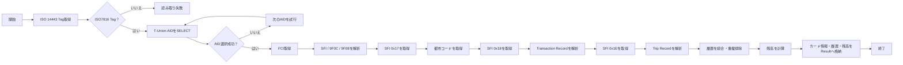
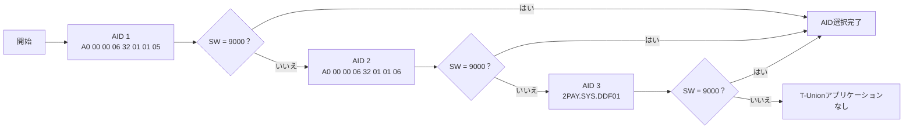
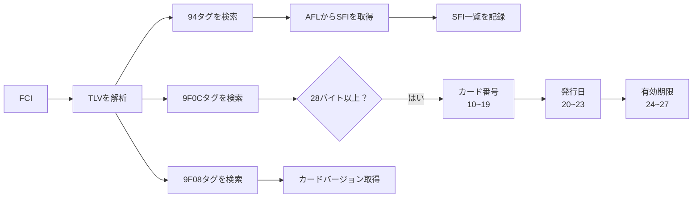
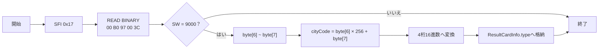
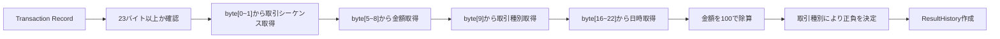
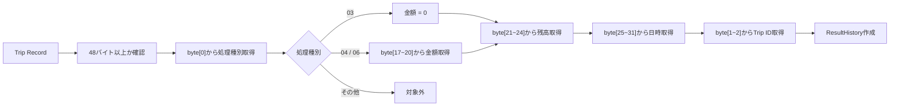
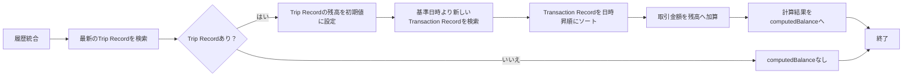
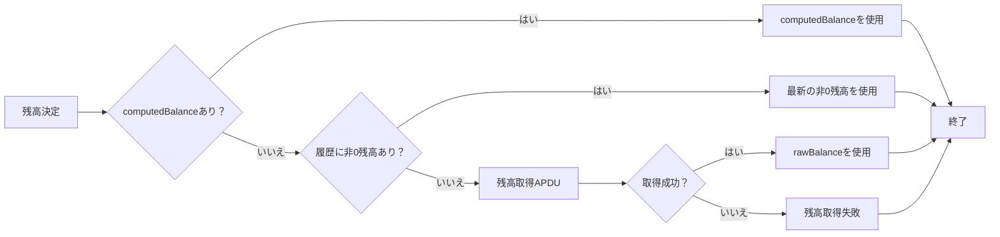

中国の交通系ICカード「T-Union」で使用されるICカードフォーマット。  
T-Unionは中国の都市間・地域間の交通ICカード相互利用を目的とした規格で、交通系ICカードとしてISO 14443系のICカードを使用する。

## カード内容

|||
|--|--|
|**NFC種別**|NFC Type-A / ISO 14443|
|通信方式|ISO 7816 APDU|
|アプリケーション|T-Union|
|AID|複数候補からSELECT|
|履歴件数|最大20件/データ領域|
|通貨|人民元(CNY)|

### AID

T-Unionアプリケーションを検索するため、以下のAIDを順番にSELECTする。

|優先順位|AID|内容|
|---|---|---|
|1|`A0 00 00 06 32 01 01 05`|T-Union AID|
|2|`A0 00 00 06 32 01 01 06`|T-Union AID|
|3|`32 50 41 59 2E 53 59 53 2E 44 44 46 30 31`|`2PAY.SYS.DDF01`|

SELECTに成功する条件は `SW1 SW2 = 90 00`。

### SELECT

|CLA|INS|P1|P2|Data|
|---|---|---|---|---|
|`00`|`A4`|`04`|`00`|AID|

---

## FCI

AIDのSELECTに成功すると、カードからFCI(File Control Information)を取得する。

FCIにはTLV形式の情報が含まれており、以下のタグを探索する。

|タグ|内容|用途|
|---|---|---|
|`94`|AFL|SFI情報の取得|
|`9F 0C`|カード情報|カード番号・発行日・有効期限等|
|`9F 08`|バージョン情報|カードバージョン|

### AFL

FCI内の`94`タグをAFL(Application File Locator)として解析する。

AFLは4バイト単位で解析し、先頭バイトの上位5ビットからSFIを取得する。

```text
SFI = AFL[0] >> 3
```

取得したSFIは重複を除去して一覧化する。

実際のデータ取得には以下のSFIを固定で使用する。

|SFI|用途|
|---|---|
|`0x17`|カード管理情報|
|`0x18`|取引履歴|
|`0x1E`|乗車履歴・Trip情報|

---

# カード情報

## SFI 0x17

カード管理情報を`READ BINARY`で取得する。

|項目|値|
|---|---|
|SFI|`0x17`|
|INS|`B0`|
|P1|`0x97`|
|P2|`0x00`|
|取得長|`0x3C`|

### READ BINARY

```text
CLA = 00
INS = B0
P1  = 97
P2  = 00
Le  = 3C
```

### データ構造


|バイト|内容|
|---|---|
|`0 ~ 3`|国際コード|
|`4 ~ 5`|省コード|
|`6 ~ 7`|都市コード|
|`8 ~ 9`|Union Card Type|
|`10`|Card Type|

### 都市コード

`6 ~ 7`の2バイトをビッグエンディアンとして結合する。

```text
cityCode = byte[6] × 256 + byte[7]
```

その後、4桁の16進数として`ResultCardInfo.type`に格納する。

---

# 9F0C カード情報

FCIから`9F 0C`タグを検索する。  
`9F 0C`のデータが28バイト以上存在する場合、以下の位置を使用する。

|バイト|内容|
|---|---|
|`0 ~ 9`|その他の情報|
|`10 ~ 19`|カード番号|
|`20 ~ 23`|発行日|
|`24 ~ 27`|有効期限|

### カード番号

`10 ~ 19`の10バイトを16進数文字列へ変換する。

この値を以下へ使用する。

|ResultCardInfo|値|
|---|---|
|`idm`|カード番号|
|`serial`|カード番号|

### 発行日・有効期限

以下の値を16進数文字列として取得する。

|バイト|内容|
|---|---|
|`20 ~ 23`|発行日|
|`24 ~ 27`|有効期限|

`ResultCardInfo.validDate`には以下の形式で格納する。

```text
発行日-有効期限
```

### バージョン

FCIから`9F 08`タグを検索し、取得した値を16進数文字列として`version`に格納する。

---

# 残高データ

T-Unionの残高取得には、以下の2種類の方法を使用する。

1. 履歴・Trip情報から残高を計算
2. 残高取得APDUによるフォールバック

## 残高取得APDU

以下のAPDUを使用する。

|CLA|INS|P1|P2|Data|
|---|---|---|---|---|
|`80`|`5C`|`00`|`02`|`04`|

成功すると4バイトの値を取得する。

### 残高変換

取得した4バイトをビッグエンディアンの整数として変換する。

```text
rawBalance = byte[0] × 256³
           + byte[1] × 256²
           + byte[2] × 256
           + byte[3]

balance = rawBalance / 100
```

したがって、カード内では1/100元単位の値として保持されているものとする。

---

# 履歴データ
以下の2つのSFIから履歴を取得する。

|SFI|内容|
|---|---|
|`0x18`|Transaction Record|
|`0x1E`|Trip Record|

どちらも`READ RECORD`を使用し、レコード番号`1 ~ 20`を順番に取得する。

---

## SFI 0x18 Transaction Record

|項目|値|
|---|---|
|SFI|`0x18`|
|INS|`B2`|
|P2|`0xC4`|
|レコード数|最大20件|
|期待データ長|23B|

### READ RECORD

```text
CLA = 00
INS = B2
P1  = レコード番号
P2  = C4
Le  = 256
```

レコード番号を`1`から`20`まで増加させて取得する。  
`SW1 SW2 = 6A 83`をレコード終端として扱う。

### データ構造

|バイト|内容|
|---|---|
|`0 ~ 1`|取引シーケンス番号|
|`2 ~ 4`|その他|
|`5 ~ 8`|金額|
|`9`|取引種別|
|`10 ~ 15`|その他|
|`16 ~ 22`|日時|

### 取引シーケンス番号

```text
transactionSeq = byte[0] × 256 + byte[1]
```

履歴の`transactionId`には以下を使用する。

```text
transactionId = 100000 + transactionSeq
```

### 金額

`5 ~ 8`の4バイトをビッグエンディアンで整数化する。

```text
amountRaw = byte[5] × 256³
          + byte[6] × 256²
          + byte[7] × 256
          + byte[8]
```

その後、100で割って人民元へ変換する。

取引種別によって正負を決定する。

|取引種別|金額|
|---|---|
|`01`|`+amountRaw / 100`|
|`02`|`+amountRaw / 100`|
|`06`|`-amountRaw / 100`|
|`09`|`-amountRaw / 100`|
|その他|`0`|

---

## SFI 0x1E Trip Record

|項目|値|
|---|---|
|SFI|`0x1E`|
|INS|`B2`|
|P2|`0xF4`|
|レコード数|最大20件|
|期待データ長|48B|

### READ RECORD

```text
CLA = 00
INS = B2
P1  = レコード番号
P2  = F4
Le  = 256
```

レコード番号を`1`から`20`まで増加させて取得する。  
`SW1 SW2 = 6A 83`をレコード終端として扱う。

### データ構造

|バイト|内容|
|---|---|
|`0`|処理種別|
|`1 ~ 2`|Trip ID等|
|`3 ~ 16`|その他|
|`17 ~ 20`|金額|
|`21 ~ 24`|残高|
|`25 ~ 31`|日時|
|`32 ~ 47`|その他|

### 処理種別

|数値|処理|
|---|---|
|`03`|残高情報|
|`04`|取引|
|`06`|取引|
|その他|対象外|

### 金額

`17 ~ 20`をビッグエンディアンで整数化し、100で割る。

`04`および`06`の場合はマイナス値として扱う。

```text
amountRaw = byte[17] × 256³
          + byte[18] × 256²
          + byte[19] × 256
          + byte[20]

amount = -amountRaw / 100
```

### 残高

`21 ~ 24`をビッグエンディアンで取得する。

```text
balanceRaw = byte[21] × 256³
           + byte[22] × 256²
           + byte[23] × 256
           + byte[24]
```

符号付き32bit整数として解釈した後、100で割る。

```text
balance = Int32(bitPattern: balanceRaw) / 100
```

### Trip ID

`1 ~ 2`をビッグエンディアンで結合する。

```text
tripId = byte[1] × 256 + byte[2]
```

`ResultHistory.transactionId`には以下を使用する。

```text
transactionId = 200000 + tripId
```

---

# 日時データ

SFI `0x18`および`0x1E`の日時は7バイトで保持される。

各バイトをBCDとして解釈する。

```text
BCD(x) = (x >> 4) × 10 + (x & 0x0F)
```

### データ構造

|バイト|内容|
|---|---|
|`0`|年 上位2桁|
|`1`|年 下位2桁|
|`2`|月|
|`3`|日|
|`4`|時|
|`5`|分|
|`6`|秒|

年は以下のように計算する。

```text
year = BCD(byte[0]) × 100 + BCD(byte[1])
```

---

# 履歴の重複排除

SFI `0x18`とSFI `0x1E`から取得した履歴を統合する際、Trip Recordについて重複排除を行う。

以下の値を組み合わせて重複判定を行う。

|項目|
|---|
|年月日|
|時分秒|
|処理種別|
|金額|
|残高|

同じキーを持つTrip Recordは1件にまとめる。

---

# 残高計算

Transaction Recordには現在の残高が直接含まれていないため、Trip Recordの残高を基準としてTransaction Recordを加減算する。

### 計算方法

1. Trip Recordを日時順に確認
2. 最新のTrip Recordを残高計算の基準とする
3. 基準日時より新しいTransaction Recordを抽出
4. Transaction Recordを古い順に並べる
5. 各取引金額を残高へ加算
6. 計算結果を現在の残高として使用

```text
計算開始残高
    ↓
最新Trip Recordの残高
    ↓
新しいTransaction Recordを取得
    ↓
日時順に並べ替え
    ↓
取引金額を加算・減算
    ↓
現在残高
```

---

# 残高の決定

最終的な残高は、以下の優先順位で決定する。

|優先順位|取得方法|
|---|---|
|1|Transaction + Trip Recordから計算した残高|
|2|履歴中の最新の0以外の残高|
|3|残高取得APDU(`80 5C 00 02 04`)|

つまり、

```text
computedBalance
    ↓ 取得成功
最終残高

    ↓ 取得できない

最新の非0残高
    ↓ 取得成功
最終残高

    ↓ 取得できない

rawBalance
    ↓
最終残高
```

---

# 履歴データのフィルタリング

履歴取得後、以下の条件に該当するデータを除外する。

```text
processType != 0x03
かつ
abs(amount) < 0.001
```

つまり、処理種別`03`以外で金額がほぼ0のレコードは履歴から除外する。

その後、以下の順番でソートする。

1. 日時の新しい順
2. 同一日時の場合は`transactionId`の大きい順

---

# フロー

## カード読み取り



***

## AID選択



***

## カード情報取得



***

## 都市コード取得



***

## 履歴取得

```mermaid
graph LR;
    A[開始] --> B["SFI 0x18"];
    B --> C["j ← 1"];
    C --> D["READ RECORD(j)<br>00 B2 j C4"];
    D --> E{"取得成功？"};
    E -- いいえ --> F["SFI 0x18終了"];
    E -- はい --> G["Transaction Record解析"];
    G --> H["j ← j + 1"];
    H --> I{"j <= 20？"};
    I -- はい --> D;
    I -- いいえ --> F;

    F --> J["SFI 0x1E"];
    J --> K["j ← 1"];
    K --> L["READ RECORD(j)<br>00 B2 j F4"];
    L --> M{"取得成功？"};
    M -- いいえ --> N["SFI 0x1E終了"];
    M -- はい --> O["Trip Record解析"];
    O --> P["j ← j + 1"];
    P --> Q{"j <= 20？"};
    Q -- はい --> L;
    Q -- いいえ --> N;
    N --> R["履歴統合"];
    R --> S["重複排除"];
    S --> T["日時順にソート"];
    T --> U[終了];
```



***

## Transaction Record解析



***

## Trip Record解析



***

## 残高計算



***

## 最終残高決定




## 参考文献
- [SocialSisterYi/T-Union_Master](https://github.com/SocialSisterYi/T-Union_Master/blob/main/docs/card_data_format.md)
- [NFC Wiki](https://wiki.nfc.im/books/智能卡手册/page/交通联合卡（t-union）)
- [薄利神社](https://www.hakurei.org.cn/2026/02/14/tunion-card-manual)