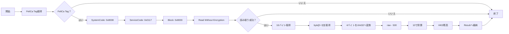
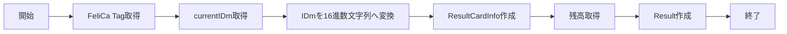
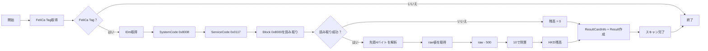

# 香港 Octopus

香港の交通系ICカード「Octopus」で使用されるICカードフォーマット。

FeliCaとして検出したOctopusカードからSystemCode `0x8008`を使用し、ServiceCode `0x0117`のデータを読み取ることで残高を取得する。

現在の実装では履歴データの取得は行っておらず、カードのIDmと残高のみを取得する。

---

## カード内容

|||
|--|--|
|**NFC種別**|NFC Type-F(FeliCa)|
|SystemCode|`0x8008`|
|ServiceCode|`0x0117`|
|ブロック数(取得)|1|
|ブロック番号|`0x8000`|
|通貨|香港ドル(HKD)|
|履歴取得|未対応|

---

# 残高データ

残高はFeliCaのServiceCode `0x0117`から取得する。

|項目|値|
|---|---|
|SystemCode|`0x8008`|
|ServiceCode|`0x0117`|
|ブロック番号|`0x8000`|
|アクセス方法|Read Without Encryption|
|取得ブロック数|1|

### データ構造

現在の実装では、取得した16バイトのうち先頭4バイトを残高データとして使用する。

|バイト|内容|
|---|---|
|`0 ~ 3`|残高|
|`4 ~ F`|未使用|

### 残高

`0 ~ 3`の4バイトをビッグエンディアンの整数として解釈する。

```text
raw = byte[0] × 256³
    + byte[1] × 256²
    + byte[2] × 256
    + byte[3]
```

Octopusの残高データは0.1香港ドル単位として扱い、さらにカードに含まれるHK$50のデポジット分を差し引く。

```text
displayBalance = max(raw - 500, 0) / 10
```

### 残高の変換例

```text
raw = 789

789 - 500 = 289

289 / 10 = 28.9 HKD
```

したがって、カード内の値が`789`の場合、アプリ上では**HK$28.9**として表示する。

デポジットを含むカード内残高と、アプリ上で表示する利用可能残高を区別している。

---

# IDm

FeliCaカードの`currentIDm`を取得し、16進数文字列へ変換する。

```text
IDm = currentIDmを2桁16進数へ変換して連結
```

例えば、

```text
01 23 45 67 89 AB CD EF
```

の場合、

```text
0123456789ABCDEF
```

として`ResultCardInfo.idm`へ格納する。

---

# カード情報

現在の実装では、以下の情報を`ResultCardInfo`へ格納する。

|項目|値|
|---|---|
|`idm`|FeliCa IDm|
|`name`|Octopus|
|`nameShort`|Octopus|
|`currency`|HKD|
|`type`|空文字|
|`serial`|なし|
|`version`|なし|
|`validDate`|なし|

カード固有情報のうち、IDm以外のシリアル番号・バージョン・有効期限などは現在取得していない。

---

# 履歴データ

現在の実装ではOctopusの利用履歴を取得していない。

`Result`は以下のように設定される。

|項目|値|
|---|---|
|`isHistory`|`false`|
|`history`|`nil`|

そのため、現在のOctopus実装で取得できる情報は以下となる。

```text
IDm
残高
```

---

# 残高取得

FeliCaの暗号化されていない領域を読み取る`readWithoutEncryption`を使用する。

### Read Without Encryption

|項目|値|
|---|---|
|SystemCode|`0x8008`|
|ServiceCode|`0x0117`|
|ブロック|`0x8000`|

Swiftでは以下の指定で読み取る。

```text
serviceCodeList = [01 17]
blockList       = [80 00]
```

取得に成功した場合、1ブロック16バイトのデータを取得する。

---

# 残高変換

取得したデータを以下の順番で変換する。

```text
16バイトのデータ
      ↓
先頭4バイトを取得
      ↓
UInt32としてビッグエンディアン変換
      ↓
raw
      ↓
500を減算
      ↓
10で除算
      ↓
香港ドル(HKD)
```

***

## 残高取得フロー



***

# カード情報取得フロー



***

# 全体フロー



---

# コンバーター

`hkOctopusConverter.swift`では、取得したデータを表示用データへ変換する。

## 残高変換

```text
balance(value) = value / 10
```

表示時には小数点以下2桁までフォーマットする。

```text
String(format: "%.2f", hkd)
```

したがって、例えば内部値が`789`の場合、

```text
78.9
```

ではなく、コンバーター単体では

```text
78.90
```

として表示される。

※`hkOctopus_balance`側ではデポジットHK$50を差し引いた値を`Result.balance`へ格納しているため、スキャン時の残高とコンバーターへ直接渡した整数値では意味が異なる点に注意。

---

## カード情報変換

`ResultCardInfo`から以下の情報を`DisplayCardInfo`へ引き継ぐ。

|DisplayCardInfo|ResultCardInfo|
|---|---|
|`idm`|`idm`|
|`name`|`name`|
|`nameShort`|`nameShort`|
|`currency`|`currency`|
|`type`|`type`|

---

## 履歴変換

現在はOctopusの履歴取得を実装していないため、`history`は以下の固定値を返す。

|項目|値|
|---|---|
|`date`|空文字|
|`processType`|空文字|
|`balance`|`0.0`|

---

# 実装上のデータ構造

```text
Octopus
│
├─ FeliCa
│   ├─ SystemCode
│   │   └─ 8008
│   │
│   └─ ServiceCode
│       └─ 0117
│           │
│           └─ Block 8000
│               ├─ 00 ~ 03 : 残高
│               └─ 04 ~ 0F : 未解析
│
└─ Card Information
    └─ IDm
```

---

# 現在の実装上の制限

- FeliCa SystemCode `0x8008`のみを使用している。
- ServiceCode `0x0117`のみを読み取っている。
- 残高データとして先頭4バイトのみを使用している。
- 残り12バイトの解析は行っていない。
- 利用履歴は取得していない。
- `ResultHistory`の生成には対応していない。
- カードのシリアル番号は取得していない。
- カードバージョンは取得していない。
- 有効期限は取得していない。
- 駅・路線・利用日時等の交通情報は取得していない。
- 現在の実装では、暗号化されたサービスへのアクセスは行っていない。

---

# 実装ファイル

|ファイル|内容|
|---|---|
|`hkOctopus.swift`|Octopusカード定義・FeliCa読み取り・IDm・残高取得|
|`hkOctopusConverter.swift`|残高・カード情報・履歴の表示用変換|

### 主な関数

|関数|内容|
|---|---|
|`hkOctopus_scan`|Octopusカード全体の読み取り|
|`hkOctopus_balance`|FeliCaから残高を取得|
|`hkOctopus_info`|IDm・カード情報を取得|
|`hkOctopus_Converter.balance`|残高表示変換|
|`hkOctopus_Converter.cardInfo`|カード情報表示変換|
|`hkOctopus_Converter.history`|履歴表示変換|

---

# 参考文献

- [Octopus - Wikipedia](https://en.wikipedia.org/wiki/Octopus_card)
