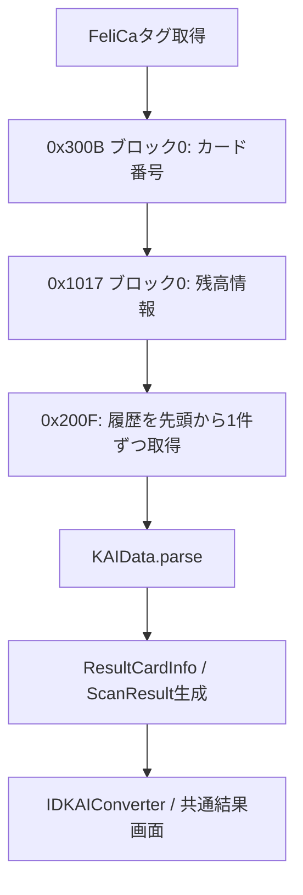

# KAI Commuter（Kartu Multi Trip / KMT）

インドネシア・ジャカルタのKAI Commuterが発行する交通ICカード。アプリ内のカードIDは`idKAI`、表示名は`Kartu Multi Trip`。

本書は2026年11月13日時点の作業ツリーにある実装を整理したものであり、発行者の公式仕様書ではない。バイトの意味・取引分類・日時補正は現在のコードの解釈を記載する。実カードでの動作検証は本書作成時には行っていない。

## 対応範囲

|項目|実装内容|
|---|---|
|通信方式|FeliCa / NFC-F（ポーリング指定は`.iso18092`）|
|System Code|`0x90B7`|
|読み取りコマンド|Read Without Encryption（暗号化なし読み取り）|
|リーダー|内蔵リーダー（Core NFC）、外部リーダー（PC/SC）で解析処理を共有|
|通貨|インドネシアルピア（IDR）|
|取得情報|IDm、カード番号、現在残高、利用履歴|
|履歴件数|最大20件|
|発行地域|インドネシア / Jakarta|
|発行者情報|KAI Commuterを固定設定|

## サービスとブロック

バイト位置はすべて0始まり。解析には各ブロック最低16バイトが必要。

|用途|Service Code|APIに渡すバイト列|ブロック番号|
|---|---|---|---|
|カード番号|`0x300B`|`0B 30`|0|
|残高情報|`0x1017`|`17 10`|0|
|利用履歴|`0x200F`|`0F 20`|0〜19|

Service Codeはリトルエンディアンで渡す。ブロックリスト要素は`80 xx`（`xx`はブロック番号）。共通の`idKAIReadBlocks`は要求を最大10ブロック単位に分割できるが、現在のカード番号・残高・履歴の呼び出しはすべて1ブロックずつ行う。

読み取り成功条件は次のすべてを満たすこと。

- 通信エラーがない。
- ステータスフラグ1・2がともに`0`。
- 返されたブロック数が要求したブロック数と一致する。
- 各ブロックが16バイトである。

## 読み取りフロー



カード番号・残高の読み取りに失敗すると、スキャン結果は`nil`となる。両ブロックのいずれかが16バイト未満でも解析は失敗する。セッションのエラー終了は共通の呼び出し元で行い、idKAIの解析処理からは終了させない。

履歴取得件数は`min(max(count, 0), 20)`に制限する。ブロック0から順に読み、最初の読み取り失敗、全バイト`00`、全バイト`FF`のいずれかで取得を終了する。それまでの履歴は保持し、履歴を1件も読めなくてもカード番号・残高が正常ならスキャン結果を生成する。履歴終端と通信障害は、この処理では区別しない。

## カード番号

`0x300B`のブロック0の先頭16バイトを使用する。

- 全バイトが`0x20`以上`0x7F`未満なら、ASCII互換のUTF-8文字列として扱い、前後の空白・改行を除去する。
- それ以外は、16バイト全体を大文字の16進数32桁に変換する。

この値は`ResultCardInfo.serial`へ格納する。IDmは別途`currentIDm`から取得し、各バイトを大文字16進数2桁で連結して`ResultCardInfo.idm`へ格納する。

## 残高情報

`0x1017`のブロック0を次のように解析する。

|バイト位置|長さ|バイト順|実装上の用途|
|---|---|---|---|
|0〜3|4|Little Endian|現在残高（`balance`）|
|4〜7|4|Little Endian|最終取引金額（`lastTransactionAmount`）|
|8〜12|5|—|未使用|
|13〜15|3|Big Endian|取引カウンター（`transactionCounter`）|

```text
balance = b[0] + (b[1] << 8) + (b[2] << 16) + (b[3] << 24)
transactionCounter = (b[13] << 16) + (b[14] << 8) + b[15]
```

現在残高は符号なし32ビット整数から`Double`へ変換して`ScanResult.balance`へ渡す。通貨はIDRで、小数点のスケーリングは行わない。最終取引金額と取引カウンターは`KAIData`に保持するが、現在の結果生成処理では使用しない。

## 履歴レコード

`0x200F`の各ブロックを1件の履歴として解析する。

|バイト位置|長さ|バイト順|実装上の用途|
|---|---|---|---|
|0〜3|4|Big Endian|日時の元値（`rawTimestamp`）|
|4〜7|4|Big Endian|金額の元値（`rawAmount`）|
|8〜9|2|Big Endian|ゲートコード（`gateCode`）|
|10〜11|2|—|未使用|
|12|1|—|取引種別（`processType`）|
|13〜15|3|Big Endian|連番（`sequenceNumber`）|

16バイト未満、先頭バイトが`00`、ゲートコードが`0`のいずれかなら、その履歴を除外する。これは履歴取得の終了条件とは別であり、解析対象から除外されたレコードの後ろにある取得済みブロックも解析する。

### 日時

```text
epoch2000 = 946684800（Unix秒）
offset = rawTimestamp < 599616000 の場合 -21600秒、それ以外は0秒
Unix秒 = epoch2000 + rawTimestamp + offset
```

上記から`Date`を生成し、グレゴリオ暦・タイムゾーン`Asia/Jakarta`で年・月・日・時・分を抽出する。秒は結果に保持しない。閾値未満に対する6時間減算の根拠や対象カード世代は、コードには説明されていない。独立した日時範囲の妥当性検証も行っていない。

### 取引種別・金額

|種別値|現在の日本語表示|`ResultHistory.balance`に格納する値|ゲートコードの格納先|
|---|---|---|---|
|0|チケット購入|`-rawAmount`|`lineIn` / `stationIn`|
|1|運賃支払い|`+rawAmount`|`lineOut` / `stationOut`|
|2|ショッピング|`-rawAmount`|`lineIn` / `stationIn`|
|その他|その他|`-rawAmount`|`lineOut` / `stationOut`|

`rawAmount`は符号なし32ビット整数を`Int64`へ変換してから符号を付ける。`ResultHistory.amount`は`nil`。フィールド名は`balance`だが、ここには現在の実装が符号を付けたレコード金額を保存している。取引後残高や入出金の意味が正しいことを本書で保証するものではない。

ゲートコードの上位バイトを`lineIn`または`lineOut`、下位バイトを`stationIn`または`stationOut`へ保存し、反対側は`0`にする。これらを実際の路線・駅名へ変換する処理はidKAIのConverterにはない。

連番は`ResultHistory.transactionId`へ格納する。解析時はブロック順を維持し、共通の結果画面では`transactionId`の降順に並べる。連番の周回補正は行わない。

## 結果・表示への変換

`ScanResult`は現在残高、解析済み履歴、カード情報を保持し、`isHistory = true`、`isLastHide = true`、Converterは`.idKAI`となる。

`ResultCardInfo`にはIDm・カード番号・固定のカード名/種別/発行地域/発行者を設定する。バージョンと有効期限は`nil`。発行者情報はカード内データから読み出した値ではない。

`IDKAIConverter.history`は日時・取引種別・`history.balance`を`DisplayHistory`へ渡す。日時文字列は`年/月/日 時:分`（時・分のみ2桁）で、時分がなければ日付のみ、年月日がなければ「不明」とする。ただし共通結果画面は`ResultHistory.date`からも日時を描画するため、この文字列だけで画面全体の表示形式が決まるわけではない。

idKAIでは符号付きレコード金額を`balance`へ格納するため、共通結果画面の隣接履歴からの差分表示を無効にする。保存済みのidKAI履歴にも適用する。金額そのものの符号規則は引き続き未確認。取引種別が`nil`の場合は「その他」と表示する。

`IDKAIConverter.cardInfo`が表示モデルへ渡す項目はIDm・名前・短縮名・通貨・種別で、`serial`は含まれない。カード番号を解析・保持することと、Converter経由で表示することは別である。

## 未確認事項

- 取引種別0・1・2の実際の意味と表示ラベルの対応、金額の符号規則。
- 履歴金額が取引額か取引後残高か、（差分表示は無効化済み）。
- 日時の6時間補正と閾値の根拠。
- ゲートコードの意味と路線・駅への対応。
- 未使用バイトの意味、カード世代ごとの差異、実カードでの内蔵・外部リーダーの動作。

## 実装参照

- [カード定義・読み取り・バイト解析](../../iOS/TransitICScanner/TransitICScanner/CardDefine/idKAI/idKAI.swift)
- [表示変換](../../iOS/TransitICScanner/TransitICScanner/CardDefine/idKAI/IDKAIConverter.swift)
- [内蔵・外部リーダーの振り分け](../../iOS/TransitICScanner/TransitICScanner/CardDefine/ScannerBranch.swift)
- [結果モデル](../../iOS/TransitICScanner/TransitICScanner/Result/ResultModel.swift)
- [共通結果画面](../../iOS/TransitICScanner/TransitICScanner/Result/ResultView.swift)
- [表示文言](../../iOS/TransitICScanner/TransitICScanner/Localize/Localizable.xcstrings)

## レビューでの修正・検証（2026年11月13日）

- 非ゼロ開始添字の`Data`スライスを解析前に正規化し、バイト参照でのクラッシュを防止。
- 履歴取得関数自体でも件数を0〜20に制限し、負数のRange生成とUInt8変換の範囲外を防止。
- 通信応答の各ブロック長を検証。空の応答ブロックを空履歴として受け入れない。
- 種別欠落時の誤分類、履歴金額同士の差分表示、セッション終了の重複を修正。
- `python3 skills/transit-card-workflow/scripts/test_idkai.py`で実装のパーサーと履歴読み取り処理を直接コンパイルし、人工データによるバイト順・スライス・短い入力・未知の取引種別・無効履歴の除外・件数境界・不正応答長・空ブロック終端を確認する。実カードのサンプルではない。

履歴読み取りの失敗と終端の区別は未解決。外部リーダーはカードのステータス異常も`Error`へ変換するため、単にすべての`Error`をスキャン失敗に変えると短い履歴を持つカードの読み取りを壊す可能性がある。終端応答の実測値または仕様の確認が必要。

## 識別子の統一（Issue #118）

コード・カードID・Converter・ローカライズキー・Asset・文書・テストは `idKAI` を正とする。Kartu Multi Trip（KMT）はカードの名称・検索語として維持する。

旧バージョンの `idKMT` / `cardList.idKMT` / `idKMT.short` / `idKMT.scand.description` / `card.KMT` / 画像名 `idKMT` は、共通の `CardIdentity` で現行名に対応させる。保存済みカードは表示用の投影時にキーを解決し、SwiftDataのスキーマ・保存プロパティ・利用者が付けた表示名・残高・履歴を変更しない。Widgetは旧JSONの画像名を表示時に解決する。新しいスキャンでは `idKAI` を保存する。

`python3 skills/transit-card-workflow/scripts/test_idkai_identity.py` で旧IDの解決、現行IDの出力、ローカライズ全言語・Asset参照、合成データを使ったSwiftDataの保存・取得・表示互換性を検証する。
