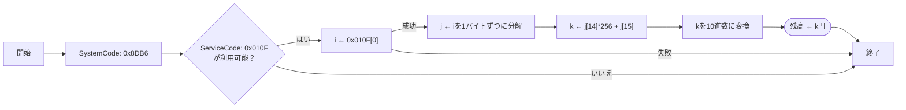
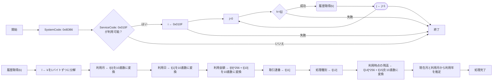

# DoCard / Asaca

北海道の旭川地域で使用されているバス用ICカード。

DoCardは道北バス、Asacaは旭川電気軌道が発行している。いずれもFeliCaをベースとした独自規格で、全国交通系ICカードのサイバネ規格とは異なる。

DoCardはFeliCaの標準的なPollingおよびRead Without Encryptionでデータを取得でき、SystemCodeは`0x8DB6`、履歴データのServiceCodeは`0x010F`であることが解析されている。

## カード内容

|||
|--|--|
|**NFC種別**|NFC Type-F(FeliCa)|
|SystemCode|0x8DB6|

### 残高データ

DoCardでは残高専用のServiceCodeを使用せず、履歴データと同じServiceCodeから残高を取得する。

|||
|--|--|
|サービスコード|0x010F|
|ブロック数(項目数)|1|
|バイト数(1ブロック)|16B|

|0 ~ 8|9 ~ A|B|C|D ~ E|F|
|-|-|-|-|-|-|
|-|[利用金額](#利用金額)|[連番](#連番)|[処理種別](#処理種別)|[残高](#残高)|-|

実装ではBlock `0`を読み取り、`14`～`15`バイトを残高として使用する。

### 履歴データ

|||
|--|--|
|サービスコード|0x010F|
|ブロック数(項目数)|20|
|バイト数(1ブロック)|16B|

|0|1|2 ~ 8|9 ~ A|B|C|D ~ E|F|
|-|-|-|-|-|-|-|-|
|月|日|-|[利用金額](#利用金額)|[連番](#連番)|[処理種別](#処理種別)|[残高](#残高)|-|

- 20ブロックまで読み取る
- 1ブロックが1件の利用履歴に対応する
- 20件を超える履歴は古いデータから上書きされると考えられる
- `00`で埋められたブロックは空データとして扱う
- 月が`1～12`、日が`1～31`の範囲外の場合も履歴として扱わない
- 公式に公開されたフォーマットではなく、解析結果に基づく構造

#### 月・日(0~1)

|数値|内容|
|---|---|
|0|月|
|1|日|

Suica等のサイバネ規格とは異なり、履歴には年が直接保存されない。

例えば、

```text
02 11 ...
```

の場合、2月11日の利用履歴となる。

年については現在の月と比較して、現在の月より未来になる場合は前年として扱う。これは実装上の推定処理であり、カード内部に保存された年を直接読み取っているわけではない。

#### 利用金額(9~A)

2バイトの16進数をビッグエンディアンとして10進数に変換する。

```text
amount = bytes[9] × 256 + bytes[10]
```

例えば、

```text
04 45
```

の場合、

```text
0x0445 = 1093
```

となり、利用金額は1093円として扱う。

#### 連番(B)

|数値|内容|
|---|---|
|1バイト|取引連番|

実装では`bytes[11]`をそのまま`transactionId`として使用する。

#### 処理種別(C)

|数値|内容|
|---|---|
|1バイト|処理種別|

実装では`bytes[12]`をそのまま`processType`として保存する。

現時点の実装では、処理種別ごとの名称変換は行っていない。

#### 残高(D~E)

2バイトの16進数をビッグエンディアンとして10進数に変換する。

```text
balance = bytes[14] × 256 + bytes[15]
```

例えば、

```text
00 26
```

の場合、

```text
0x0026 = 38
```

となり、残高は38円となる。

## フロー

### 残高取得



***

### 履歴取得



***

## 実装上の注意

DoCardの実装では、Core NFCの`NFCFeliCaTag.readWithoutEncryption()`を使用している。

Service CodeはFeliCaのバイト列としては、

```text
0F 01
```

を指定する。これはFeliCaのリトルエンディアン表現で、数値としてのServiceCode `0x010F`に対応する。

Block Listは、

```text
Data([0x80, block])
```

として作成しており、Block `0`～`19`を読み取っている。

DoCardの公開解析でも、System Code `0x8DB6`、Service Code `0x010F`に対してRead Without Encryptionを行い、Block 0～19を読み取る構成が確認されている。

### 年の推定

カードには月・日のみが保存されているため、実装では現在年を基準にしている。

例えば現在が2026年9月で、

```text
09/20
```

なら2026年9月20日、

```text
12/20
```

なら現在月より未来なので2025年12月として扱う。

ただしこの方法では、カードを1年以上利用しなかった場合などに正しい年を判定できない場合がある。


## 参考文献

- [旭川のバスカード「DoCard」の残高をAndroidで読むアプリを作った](https://www.mimoex.net/260308-docard-balance-androidapp/)
- [ICカード これひとつ FAQ](https://allnfc.app/jp/faq/tran_local.html)
- [マルチICカードリーダー](https://apps.apple.com/jp/app/%E3%83%9E%E3%83%AB%E3%83%81ic%E3%82%AB%E3%83%BC%E3%83%89%E3%83%AA%E3%83%BC%E3%83%80%E3%83%BC-ic%E3%82%AB%E3%83%BC%E3%83%89%E6%AE%8B%E9%AB%98%E7%A2%BA%E8%AA%8D%E3%82%A2%E3%83%97%E3%83%AA/id1478703111)
- [DoCARD ‐ 通信用語の基礎知識](https://www.wdic.org/w/RAIL/DoCARD)