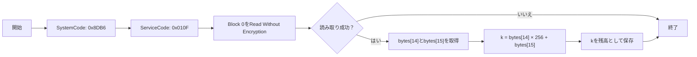
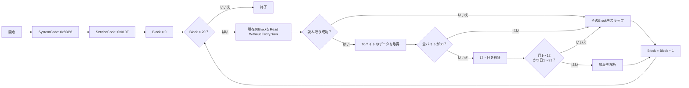
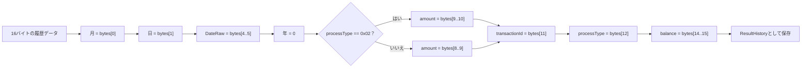

# DoCard / Asaca

北海道の旭川地域で使用されているバス用ICカード。

DoCardは道北バス、Asacaは旭川電気軌道が発行している。いずれもFeliCaをベースとした独自規格で、全国交通系ICカードのサイバネ規格とは異なる。

DoCardはFeliCaのPollingおよびRead Without Encryptionでデータを取得でき、SystemCodeは`0x8DB6`、履歴および残高取得に使用するServiceCodeは`0x010F`である。

## カード内容

|||
|--|--|
|**NFC種別**|NFC Type-F(FeliCa)|
|SystemCode|0x8DB6|

### 残高データ

現在の実装では、残高専用のServiceCodeではなく、履歴データと同じServiceCode `0x010F` から残高を取得する。

|||
|--|--|
|サービスコード|0x010F|
|ブロック数(項目数)|1|
|バイト数(1ブロック)|16B|

|0 ~ 8|9 ~ A|B|C|D ~ E|F|
|-|-|-|-|-|-|
|-|利用金額|連番|処理種別|残高|-|

実装ではBlock `0`を読み取り、`bytes[14]`～`bytes[15]`を残高として使用する。

例えば、以下のデータの場合、

```text
02 15 0A 30 02 03 06 A6 06 72 00 01 1E 00 06 72
```

`bytes[14]`～`bytes[15]`は`06 72`となる。

```text
0x0672 = 1650
```

したがって、残高は1650円として扱われる。

### 履歴データ

|||
|--|--|
|サービスコード|0x010F|
|最大ブロック数(項目数)|20|
|バイト数(1ブロック)|16B|

|0|1|2 ~ 8|9 ~ A|B|C|D ~ E|F|
|-|-|-|-|-|-|-|-|
|月|日|-|利用金額|連番|処理種別|残高|-|

現在の実装では、Block `0`～`19`を1ブロックずつ読み取る。

- 1ブロックが1件の利用履歴に対応する
- `00`で埋められたブロックは空データとして扱う
- 月が`1～12`、日が`1～31`の範囲外の場合は履歴として扱わない
- 有効な履歴だけを`ResultHistory`として保存する
- 20ブロックをまとめて読み取るのではなく、各Blockを個別にRead Without Encryptionする

## 月・日(0~1)

|バイト|内容|
|---|---|
|0|月|
|1|日|

Suica等のサイバネ規格とは異なり、履歴には年が保存されない。

例えば、

```text
02 15 ...
```

の場合、2月15日の利用履歴となる。

現在の実装では、カード内部に年が存在しないため、年を現在年やDateRawから推定しない。

`DateComponents`には、

```text
year = 0
month = 読み取った月
day = 読み取った日
```

として保存する。

`year = 0`は年不明を表す。

そのため、例えば、

```text
year = 0
month = 2
day = 15
```

という履歴は、画面上では、

```text
2/15
```

と表示する。


## 利用金額

利用金額は処理種別によって読み取る位置が異なる。

処理種別が`0x02`の場合は、`bytes[9]`～`bytes[10]`を利用金額として扱う。

それ以外の処理種別では、`bytes[8]`～`bytes[9]`を金額として扱う。

いずれも2バイトのビッグエンディアンとして10進数に変換する。

処理種別`0x02`の場合:

```text
amount = bytes[9] × 256 + bytes[10]
```

それ以外の場合:

```text
amount = bytes[8] × 256 + bytes[9]
```

なお、処理種別によって金額フィールドの位置が異なるため、単純に常に`bytes[9]`～`bytes[10]`を利用金額とする実装ではない。

## 連番(B)

|数値|内容|
|---|---|
|1バイト|取引連番|

例えば、

```text
bytes[11] = 01
```

の場合、

```text
transactionId = 1
```

となる。

## 処理種別(C)

|数値|内容|
|---|---|
|1バイト|処理種別|

|値|表示上の扱い|
|---|---|
|`0x1E`|新規発行|

## 残高(D~E)

2バイトの16進数をビッグエンディアンとして10進数に変換する。

```text
balance = bytes[14] × 256 + bytes[15]
```

例えば、

```text
00 26
```

の場合、

```text
0x0026 = 38
```

となり、残高は38円となる。


```text
06 72
```

の場合は、

```text
0x0672 = 1650
```

となり、残高は1650円となる。

## フロー

### 残高取得



***

### 履歴取得



### 履歴解析



## 参考文献

- [旭川のバスカード「DoCard」の残高をAndroidで読むアプリを作った](https://www.mimoex.net/260308-docard-balance-androidapp/)
- [DoCARD ‐ 通信用語の基礎知識](https://www.wdic.org/w/RAIL/DoCARD)
