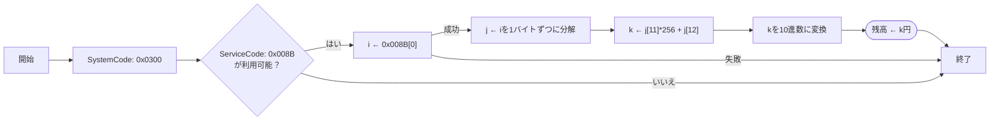
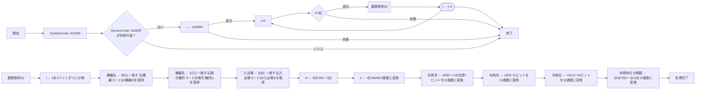

CJRC規格とも呼ばれる、日本の交通系IC(交通系ICカード全国相互利用サービス)使用される共通規格。日本鉄道サイバネティクス協議会が策定  
FeliCaベースのIC乗車券、またここから取得できる駅コードについて定義している。  
公式情報は公開されていないが、有志により調査が進んでいる。  
全国相互利用に対応しない一部の交通系ICも、非公式ながらサイバネ規格と同様のフォーマットを実装している場合もある。ただしシステムコードは異なる。

## カード内容
|||
|--|--|
|**NFC種別**|NFC Type-F(FeliCa)|
|SystemCode|0x0300|

#### サイバネ準拠カード
非公式のサイバネ準拠カードのSystemCode
|種別|SystemCode|
|--|--|
|IruCa|0xDE80|
|SAPICA|0x865E|

### 残高データ
|||
|--|--|
|サービスコード|0x008B|
|ブロック数(項目数)|1|
|バイト数(1ブロック)|16B|

|0 ~ A|B ~ C|D ~ F|
|-|-|-|
|-|[残高](サイバネ規格#残高)|-|

### 履歴データ
|||
|--|--|
|サービスコード|0x090F|
|ブロック数(項目数)|20|
|バイト数(1ブロック)|16B|

|0|1|2|3|4 ~ 5|6~9|A~B|C|D|E|F|
|-|-|-|-|-|-|-|-|-|-|-|
|[機器](サイバネ規格#機器0)|[取引種別](サイバネ規格#取引種別1)|-|[入出場](サイバネ規格#入出場3)|[履歴](サイバネ規格#履歴45)|駅コード|[残高](サイバネ規格#残高AB)|-|-|-|-|-|-|-|

 - 20件以上の履歴は上書きされる
 - 空データはF埋め

#### 機器(0)
|数値|内容|
|---|---|
|16|改札|
|17|改札|
|08|券売機|
|12|券売機|
|07|券売機|
|1C|券売機|
|15|定期券売機|
|1F|チャージ端末|
|03|のりこし精算|
|18|駅端末|
|1A|駅窓口|
|19|みどりの窓口|
|05|バス等|
|1D|乗換|
|36|バス等|
|C7|ショッピング|
|C8|ショッピング|
|1B|モバイル|

#### 取引種別(1)
|数値|内容|
|---|---|
|01|自動改札機出場|
|02|SFチャージ|
|03|きっぷ購入|
|04|磁気券精算|
|05|乗越精算|
|06|窓口出場|
|07|新規発行|
|08|控除|
|0D|バス等|
|0F|バス等|
|11|再発行|
|13|料金出場|
|14|オートチャージ|
|1F|バス等チャージ|
|46|物販|
|48|ポイントチャージ|
|4B|入場・物販|

#### 入出場(3)
|数値|内容|
|---|---|
|01|入場|
|02|出場|
|03|定期入場|
|04|定期出場|
|0E|窓口出場|
|0F|バス等|
|12|乗り越し等|
|17|乗り継ぎ|
|21|バス等乗り継ぎ|

#### 履歴(4~5)
2バイトの16進数をそれぞれ2進数に変換し、下記のビットに分けてから10進数に直す。  
295Fの場合、0010100=20,1010=10,11111=31で、2020年10月31日になる。

|数値|内容|
|---|---|
|7ビット|年(下2桁)|
|4ビット|月|
|5ビット|日|

#### 駅コード(6~9)
サイバネ企画で定められた駅コードが記載

#### 残高
2バイトの16進数を10進数に変換する。  
残高は最大で20000円（4E202）  
取引額は取得できないため、取引日時順にソートした上で現在の残高から残高を足し引きして計算する。

## フロー
### 残高取得

***

### 履歴取得

***

## 参考文献
- [今まで調べたICカードの一覧](http://jennychan.web.fc2.com/format/suica.html)