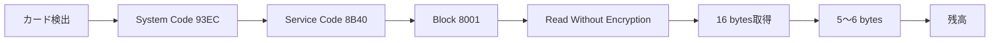
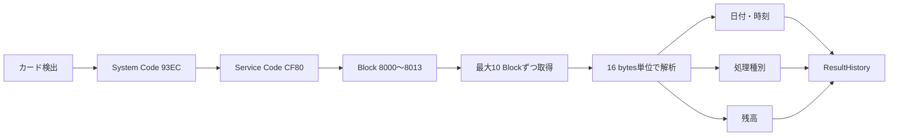
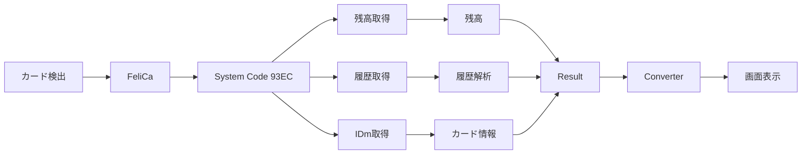

# エヌタスカード

長崎県で使用される交通系ICカード「エヌタスカード」に対応したICカードフォーマット。  
FeliCaを使用し、System Code `0x93EC`のサービスから残高および利用履歴を取得する。

現在の実装では、カードIDm・残高・最大20件の履歴を取得する。

## カード内容

|||
|--|--|
|**NFC種別**|NFC Type-F / FeliCa|
|通信方式|FeliCa Read Without Encryption|
|System Code|`0x93EC`|
|残高Service Code|`0x8B40`|
|履歴Service Code|`0xCF80`|
|残高Block|`0x8001`|
|履歴Block|`0x8000` ～ `0x8013`|
|履歴件数|最大20件|
|通貨|日本円(JPY)|

### System Code

カード検出時に以下のSystem Codeを使用する。

```text
93 EC
```

実装では以下を指定する。

```text
felicaSystemCodes = ["93EC"]
```

---

# 残高データ

残高はService Code `0x8B40`のBlock `0x8001`から取得する。

|項目|値|
|---|---|
|System Code|`0x93EC`|
|Service Code|`0x8B40`|
|Block|`0x8001`|
|アクセス方式|Read Without Encryption|
|データ長|16 bytes|

### Service Code

実装では以下のService Codeを使用する。

```text
Data([0x40, 0x8B].reversed())
```

これによりFeliCaのService Codeは、

```text
0x8B40
```

となる。

### Block

残高取得には以下のBlockを使用する。

```text
80 01
```

実装では、

```text
Data([0x80, 0x01])
```

として指定する。

### READ WITHOUT ENCRYPTION

```text
System Code = 93 EC
Service Code = 8B 40
Block = 80 01
```

`readWithoutEncryption`を実行し、Status Flagが`00 00`の場合にデータを取得する。

### 残高データ構造

取得した16バイトのBlockから、5～6バイト目を残高として使用する。

|バイト|内容|
|---|---|
|`0 ~ 4`|その他|
|`5 ~ 6`|残高|
|`7 ~ 15`|その他|

残高は2バイトの値として取得する。

実装では`toIntReversed(5, 6)`を使用しているため、対象バイトをリトルエンディアンとして整数化する。

```text
balance = byte[5] + byte[6] × 256
```

取得した値を`Int`へ変換し、`Result.balance`へ渡す。

---

# 履歴データ

利用履歴はService Code `0xCF80`から取得する。

最大20件の履歴を取得する。

|項目|値|
|---|---|
|System Code|`0x93EC`|
|Service Code|`0xCF80`|
|アクセス方式|Read Without Encryption|
|最大件数|20件|
|1件あたり|16 bytes|
|Block|`0x8000` ～ `0x8013`|

### Service Code

実装では以下のService Codeを使用する。

```text
Data([0x80, 0xCF].reversed())
```

これによりFeliCaのService Codeは、

```text
0xCF80
```

となる。

### Block

履歴はBlock `0x8000`から取得する。

```text
Data([0x80, UInt8(block)])
```

取得対象は以下の範囲となる。

|履歴番号|Block|
|---:|---|
|1|`0x8000`|
|2|`0x8001`|
|3|`0x8002`|
|...|...|
|20|`0x8013`|

### 複数Block取得

一度に取得するBlock数は最大10件とする。

```text
blocksPerRead = 10
```

20件を取得する場合は、以下の2回に分割する。

```text
0x8000 ～ 0x8009
```

```text
0x800A ～ 0x8013
```

取得したデータを連結し、各16バイトを1件の履歴として解析する。

---

# 履歴データ構造

1件の履歴は16バイトで構成される。

|バイト|内容|
|---|---|
|`0 ~ 1`|日付|
|`2`|時|
|`3`|分|
|`4`|秒|
|`5 ~ 12`|その他|
|`13`|処理種別|
|`14 ~ 15`|残高|

---

# 日付データ

`0 ~ 1`の2バイトを16bit値として結合する。

```text
rawDate = byte[0] × 256 + byte[1]
```

その後、ビット単位で年月日を取得する。

```text
year  = ((rawDate >> 9) & 0x7F) + 2000
month = (rawDate >> 5) & 0x0F
day   = rawDate & 0x1F
```

### ビット構造

|ビット|内容|
|---|---|
|`15 ~ 9`|年|
|`8 ~ 5`|月|
|`4 ~ 0`|日|

年は2000を基準とする。

```text
year = 年値 + 2000
```

---

# 時刻データ

時刻は2～4バイト目に格納される。

|バイト|内容|
|---|---|
|`2`|時|
|`3`|分|
|`4`|秒|

そのまま`DateComponents`へ格納する。

```text
hour   = byte[2]
minute = byte[3]
second = byte[4]
```

日付と時刻をまとめて以下の`DateComponents`を生成する。

```text
DateComponents(
    year: year,
    month: month,
    day: day,
    hour: hour,
    minute: minute,
    second: second
)
```

---

# 処理種別

13バイト目に処理種別が格納される。

|値|内容|
|---|---|
|`0x10`|新規発行|
|`0x40`|バス|
|`0x50`|チャージ|
|`0xC0`|物販|
|その他|その他|

コンバーターでは以下のローカライズ文字列へ変換する。

```text
0x10 → result.history.new
0x40 → result.history.bus
0x50 → result.history.charge
0xC0 → result.history.shopping
その他 → result.history.other
```

---

# 履歴残高

14～15バイト目に履歴取得時点の残高が格納される。

```text
balance = byte[14] × 256 + byte[15]
```

実装では以下の処理で取得する。

```text
Double(UInt16(bytes[14]) << 8 | UInt16(bytes[15]))
```

したがって、履歴残高はビッグエンディアンのUInt16として解釈される。

---

# 履歴解析

取得したBlockを16バイト単位で解析する。

### データ長チェック

```text
bytes.count == 16
```

16バイトでないデータは履歴として扱わない。

### 空データチェック

16バイトすべてが`0x00`の場合は除外する。

```text
bytes.allSatisfy { $0 == 0 }
```

処理は以下のようになる。

```text
16 bytes取得
    ↓
16 bytesか確認
    ↓ No
除外

    ↓ Yes
全て0x00か確認
    ↓ Yes
除外

    ↓ No
履歴として解析
```

---

# ResultHistory

解析した履歴は`ResultHistory`として生成する。

|項目|値|
|---|---|
|`processType`|Block `13`|
|`date`|Block `0 ~ 4`から生成|
|`balance`|Block `14 ~ 15`|
|`amount`|`nil`|
|`lineIn`|`0`|
|`stationIn`|`0`|
|`lineOut`|`0`|
|`stationOut`|`0`|
|`transactionId`|`0`|

現在の実装では、金額・入場駅・出場駅・路線・取引IDは取得していない。

---

# カード情報

カード情報としてFeliCaのIDmを取得する。

```text
felicaTag.currentIDm
```

IDmの各バイトを16進数2桁へ変換し、連結する。

例えば、

```text
01 23 45 67 89 AB CD EF
```

の場合、

```text
0123456789ABCDEF
```

となる。

### ResultCardInfo

|ResultCardInfo|値|
|---|---|
|`idm`|FeliCa IDm|
|`name`|`jpNplus.name`|
|`nameShort`|`jpNplus.scanOption.nameShort`|
|`currency`|`jpNplus.scanOption.currency`|
|`type`|空文字列|
|`serial`|`nil`|
|`version`|`nil`|
|`validDate`|`nil`|

---

# 履歴取得件数

`ScanOption`では履歴件数を20件として指定している。

```text
historyCount = 20
```

履歴取得時には指定された件数を以下の範囲へ制限する。

```text
blockCount = min(max(count, 1), 20)
```

そのため、取得件数は最低1件、最大20件となる。

|要求件数|実際の取得件数|
|---:|---:|
|`0`|1|
|`1`|1|
|`10`|10|
|`20`|20|
|`30`|20|

---

# 残高取得処理

`jpNplusBalance`では、以下のService CodeとBlockを使用して残高を取得する。

```text
Service Code = 0x8B40
Block        = 0x8001
```

処理の流れは以下の通り。

```text
FeliCaカード
    ↓
Service Code 8B40
    ↓
Block 8001
    ↓
Read Without Encryption
    ↓
16 bytes
    ↓
5～6 bytes
    ↓
残高
```

読み取りに失敗した場合、`nil`を返す。

また、読み取りエラーまたはStatus Flag異常の場合はNFCセッションを終了する。

---

# 履歴取得処理

`jpNplusHistory`では、以下のService Codeを使用する。

```text
Service Code = 0xCF80
```

指定された件数からBlock Listを生成する。

```text
0x8000
0x8001
0x8002
...
```

10BlockごとにRead Without Encryptionを実行する。

```text
最大10 Block
    ↓
Read Without Encryption
    ↓
次の10 Block
    ↓
Read Without Encryption
```

すべてのBlock取得後、16バイト単位で履歴を解析する。

---

# 共通読み取り処理

`jpNplusRead`では、指定されたService CodeとBlock番号を使用して読み取りを行う。

### Block生成

```text
Data([0x80, block])
```

指定されたBlock番号からBlock Listを生成する。

### READ WITHOUT ENCRYPTION

```text
Service Code
    ↓
Block List
    ↓
readWithoutEncryption
    ↓
Status Flag確認
    ↓
Data
```

Status Flagが`00 00`以外の場合は`nil`を返す。

---

# 複数Block読み取り

`jpNplusReadMultiple`では、`0`から指定された件数までのBlockを生成する。

```text
(0..<count)
```

からBlock Listを作成する。

```text
0x8000
0x8001
0x8002
...
```

その後、Read Without Encryptionを1回実行する。

現在の実装では、履歴取得本体はこの関数ではなく、`jpNplusHistory`内で10Block単位に分割して読み取っている。

---

# コンバーター

`JPNplusConverter.swift`では、取得したカード情報・履歴を表示用データへ変換する。

## history

`ResultHistory`を`DisplayHistory`へ変換する。

|入力|出力|
|---|---|
|`date`|日付文字列|
|`processType`|処理種別文字列|
|`balance`|残高|

### 日付

年月日を以下の形式へ変換する。

```text
YYYY/M/D
```

例えば、

```text
2026年9月11日
```

は、

```text
2026/9/11
```

となる。

年月日のいずれかが存在しない場合は、

```text
unknown
```

を返す。

### 処理種別

```text
0x10 → result.history.new
0x40 → result.history.bus
0x50 → result.history.charge
0xC0 → result.history.shopping
その他 → result.history.other
```

---

# cardInfo

`ResultCardInfo`を`DisplayCardInfo`へ変換する。

|入力|出力|
|---|---|
|`idm`|`idm`|
|`name`|`name`|
|`nameShort`|`nameShort`|
|`currency`|`currency`|
|`type`|`type`|

---

# 残高取得フロー



***

# 履歴取得フロー



***

# カード情報取得フロー


***

# 全体フロー



***