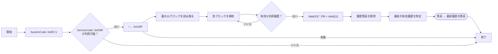
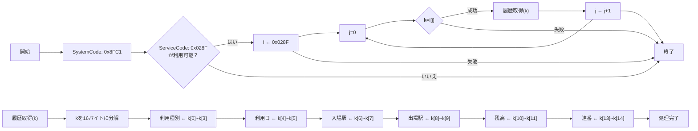

# OKICA

沖縄県内の公共交通で利用される交通系ICカード。沖縄ICカード株式会社が発行し、沖縄都市モノレール（ゆいレール）や沖縄県内のバスなどで利用されているFeliCaベースのIC乗車券。

## カード内容

|||
|--|--|
|**NFC種別**|NFC Type-F(FeliCa)|
|SystemCode|`0x8FC1`|

### サービスコード

|サービス|ServiceCode|ブロック数(項目数)|用途|
|--|--|--:|--|
|利用履歴|`0x028F`|20|OKICAの利用履歴・残高|

1ブロックは16バイト。
---

## 利用履歴データ

|項目|内容|
|--|--|
|サービスコード|`0x028F`|
|ブロック数(項目数)|20|
|バイト数(1ブロック)|16B|

|0 ~ 3|4 ~ 5|6 ~ 7|8 ~ 9|A ~ B|C|D ~ E|F|
|-|-|-|-|-|-|-|-|
|利用種別|利用日|入場駅|出場駅|残高|-|連番|-|

20ブロックのうち、実際の利用履歴を順番に格納する。

空きデータや無効なデータについては、日付などを検証して利用可能な履歴のみを採用する。

### 利用種別(0 ~ 3)

4バイトを32bitの値として扱う。

`data[0] << 24 | data[1] << 16 | data[2] << 8 | data[3]`

|値|内容|種別|
|---|---|---|
|`16 01 00 02`|ゆいレール（移動）|乗車|
|`08 02 00 00`|ゆいレール（チャージ）|チャージ|
|`08 48 00 00`|ポイントチャージ|ポイント交換|
|`08 48 04 00`|ポイントチャージ|ポイント交換|
|`05 1F 00 00`|バス（チャージ）|チャージ|
|`05 0F 00 0F`|バス（移動）|乗車|
|`08 07 00 00`|新規発行|カード発行|
|`1F 1F 00 00`|チャージ機|チャージ|

上記以外の値は未知の利用種別として扱う。

---

## 利用日(4 ~ 5)

2バイトを以下の形式で格納する。

|ビット|内容|
|---|---|
|上位7ビット|年（2000年からの年数）|
|下位9ビット|月・日|

上位7ビットに2000を足して計算する。

---

## 入場駅(6 ~ 7)

2バイトの駅コード。

## 残高(A ~ B)

利用履歴1件につき、利用後の残高が格納されている。   

## フロー

### 残高取得

OKICAには、一般的なICカードのような独立した残高サービスが存在しないため、最新の履歴から残高を特定する。

***

### 履歴取得

## 参考文献

- [TRETJapanNFCReader](https://github.com/treastrain/TRETJapanNFCReader/)