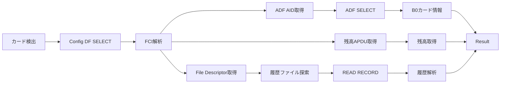

# 韓国 One Card

韓国で使用される交通ICカード「One Card」に対応したICカードフォーマット。  
ISO 14443 / ISO 7816 APDUを使用し、Config DFからカード固有のADF・残高取得APDU・ファイル情報を取得する。

## カード内容

|||
|--|--|
|**NFC種別**|NFC Type-A / ISO 14443|
|通信方式|ISO 7816 APDU|
|Config DF AID|`A0 00 00 04 52 00 01`|
|標準ADF AID|`D4 10 00 00 03 00 01`|
|履歴件数|最大20件|
|履歴ファイル|EFTRANS|
|履歴SFI|`0x04`|
|通貨|韓国ウォン(KRW)|

### AID

最初にConfig DFをSELECTする。

|項目|値|
|---|---|
|Config DF|`A0 00 00 04 52 00 01`|
|標準ADF|`D4 10 00 00 03 00 01`|

Config DFのFCIからメインADFのAIDを取得できる場合は、そのAIDを使用する。

`4F`タグが存在しない場合は、以下の標準ADF AIDを使用する。

```text
D4 10 00 00 03 00 01
```

### Config DF SELECT

```text
CLA = 00
INS = A4
P1  = 04
P2  = 00
Data = A0 00 00 04 52 00 01
Le  = 256
```

SELECTに成功する条件は、

```text
SW1 SW2 = 90 00
```

である。

---

# Config DF

Config DFをSELECTするとFCIが返される。

FCIから以下のTLVを探索する。

|タグ|内容|用途|
|---|---|---|
|`4F`|ADF AID|メインADFの選択|
|`11`|残高APDU Descriptor|残高取得APDUの決定|
|`9F 10`|File Descriptor|カード内ファイル情報の取得|

### ADF AID

`4F`タグからメインADFのAIDを取得する。

```text
4F = ADF AID
```

取得したAIDをメインADFのSELECTに使用する。

`4F`が存在しない場合は、以下のAIDへフォールバックする。

```text
D4 10 00 00 03 00 01
```

### 残高APDU Descriptor

`11`タグが存在し、データ長が5バイトの場合、残高取得APDUとして使用する。

|バイト|内容|
|---|---|
|`0`|CLA|
|`1`|INS|
|`2`|P1|
|`3`|P2|
|`4`|Le|

以下の5バイトをAPDUとして使用する。

```text
CLA INS P1 P2 Le
```

`11`タグが存在しない場合は、実装上のデフォルトAPDUを使用する。

### File Descriptor

`9F 10`タグには3バイト単位のFile Descriptorが格納される。

|バイト|内容|
|---|---|
|`0`|ファイル種別 + SFI|
|`1 ~ 2`|最大データ長|

各Descriptorは以下のように解析する。

```text
fileType = byte[0] >> 5
SFI      = byte[0] & 0x1F
maxLength = byte[1] × 256 + byte[2]
```

取得したDescriptorからカード内ファイルのSFIと最大データ長を取得する。

---

# メインADF

Config DFから取得したADF AIDをSELECTする。

### SELECT

```text
CLA = 00
INS = A4
P1  = 04
P2  = 00
Data = ADF AID
Le  = 256
```

SELECTに成功するとADFのFCIを取得する。

成功条件は、

```text
SW1 SW2 = 90 00
```

である。

ADFのFCIから`B0`タグを検索し、カード情報を取得する。

---

# カード情報

## B0 カード情報

ADFのFCIから`B0`タグを探索する。

`B0`にはカード種別、カード番号、発行日、有効期限などの情報が格納される。

|バイト|内容|
|---|---|
|`0`|CARDTYPE|
|`1`|ALG|
|`2`|VK|
|`3`|IDCENTER|
|`4 ~ 11`|CSN|
|`12 ~ 16`|IDTR|
|`17 ~ 20`|発行日|
|`21 ~ 24`|有効期限|
|`25`|USERCODE|
|`26`|DISRATE|
|`27 ~ 30`|BALMAX|

### CARDTYPE

`B0[0]`をカード種別として取得する。

```text
CARDTYPE = byte[0]
```

16進数2桁の文字列として`ResultCardInfo.version`へ格納する。

### CSN

`B0[4 ~ 11]`の8バイトをカード番号として使用する。

```text
CSN = byte[4...11]
```

16進数文字列へ変換し、以下へ使用する。

|ResultCardInfo|値|
|---|---|
|`idm`|CSN|
|`serial`|CSN|

### 発行日

`B0[17 ~ 20]`の4バイトをBCDとして解析する。

```text
year  = BCD(byte[0]) × 100 + BCD(byte[1])
month = BCD(byte[2])
day   = BCD(byte[3])
```

以下の形式へ変換する。

```text
YYYY-MM-DD
```

### 有効期限

`B0[21 ~ 24]`も同様にBCDとして解析する。

```text
YYYY-MM-DD
```

発行日と有効期限を`-`で連結して`ResultCardInfo.validDate`へ格納する。

```text
発行日-有効期限
```

### BALMAX

`B0[27 ~ 30]`をビッグエンディアンのUInt32として取得する。

```text
balMax = byte[27] × 256³
       + byte[28] × 256²
       + byte[29] × 256
       + byte[30]
```

取得した値をカードの最大残高情報として扱う。

---

# 残高データ

残高取得にはConfig DFの`11`タグから取得したAPDU Descriptorを使用する。

取得した5バイトを以下の形式として解釈する。

```text
CLA INS P1 P2 Le
```

### 残高取得

```text
Config DF
    ↓
FCI取得
    ↓
11タグ検索
    ↓
残高APDU取得
    ↓
APDU送信
    ↓
レスポンス取得
    ↓
残高変換
```

APDUのレスポンスデータから残高を取得する。

残高値はビッグエンディアンとして整数化する。

```text
balance = byte[0] × 256³
        + byte[1] × 256²
        + byte[2] × 256
        + byte[3]
```

---

# 履歴データ

カード内のFile Descriptorから履歴ファイルを特定する。

履歴ファイルに対して`READ RECORD`を使用し、レコード番号を順番に増加させて取得する。

最大20件まで取得する。

## EFTRANS

交通利用履歴はEFTRANSから取得する。

|項目|値|
|---|---|
|ファイル名|EFTRANS|
|SFI|`0x04`|
|取得方式|READ RECORD|
|最大件数|20件|

### READ RECORD

```text
CLA = 00
INS = B2
P1  = レコード番号
P2  = (SFI << 3) | 04
Le  = 256
```

レコード番号を`1`から順番に増加させて取得する。

レコードが存在しない場合は、履歴取得を終了する。

---

# 日時データ

カード内の日付・時刻はBCD形式で格納されている。

BCDは以下のように変換する。

```text
BCD(x) = (x >> 4) × 10 + (x & 0x0F)
```

年月日・時刻を解析し、`Date`へ変換する。

```text
年
月
日
時
分
秒
    ↓
Date
```

---

# 履歴変換

取得した各レコードを`ResultHistory`へ変換する。

|ResultHistory|内容|
|---|---|
|`transactionId`|カード内履歴ID|
|`date`|取引日時|
|`processType`|取引種別|
|`balance`|取引後残高|

取得した履歴は日時順に処理し、アプリケーション上の履歴データへ変換する。

---

# カード情報取得フロー


***

# 残高取得フロー


***

# 履歴取得フロー


***

# 全体フロー



---

# 参考文献

- [Metrodroid](https://github.com/metrodroid/metrodroid/wiki/South-Korea#d4100000030001)