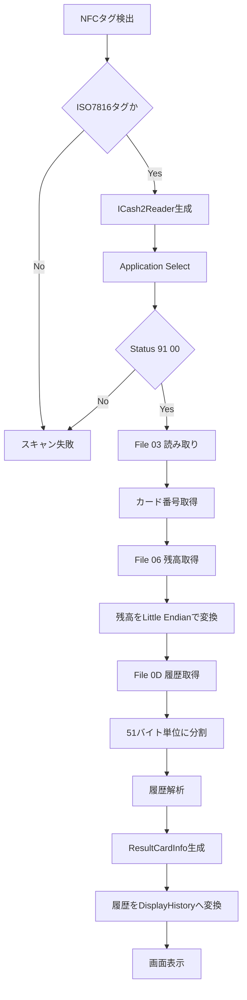

# iCash 2.0

## 概要

iCash 2.0は、台湾で利用される非接触型ICカードであり、NFC Type-A / ISO 14443系のインターフェースを使用する。

カードへのアクセスにはCore NFCの`NFCISO7816Tag`を使用し、iCash 2.0固有のAPDUコマンドによってカード情報、残高、利用履歴を取得する。

カード情報としてカード番号を取得でき、残高は台湾ドル（TWD）として扱う。利用履歴には利用日時、Mapping ID、加盟店名、取引金額、取引コードなどが格納されている。

本実装では以下の情報を取得する。

| 情報 | 内容 |
|---|---|
| カード番号 | File ID `03`から8バイトを取得 |
| 残高 | File ID `06`から4バイトを取得 |
| 利用履歴 | File ID `0D`から取得 |
| 履歴件数 | 最大20件 |
| 履歴レコード長 | 1件あたり51バイト |
| 通貨 | TWD |
| NFC方式 | ISO 14443 / ISO 7816インターフェース |
| カード識別 | iCash 2.0 |

---

## NFCアクセス

Core NFCでは`NFCISO7816Tag`としてカードを取得する。

カードがISO 7816タグとして認識できない場合、スキャンは失敗する。

```text
NFCReaderSession
      │
      ▼
NFCISO7816Tag
      │
      ▼
ICash2Reader
      │
      ├── Select Application
      ├── Read Card Number
      ├── Read Balance
      └── Read Recent Records
```

---

## アプリケーション選択

iCash 2.0では、以下のAIDを使用してアプリケーションを選択する。

| 項目 | 値 |
|---|---|
| AID | `11 87 16` |
| CLA | `90` |
| INS | `5A` |
| P1 | `00` |
| P2 | `00` |
| Le | `256` |

送信APDU:

```text
90 5A 00 00 11 87 16
```

正常終了時のステータスワードは`91 00`である。

---

## カード情報取得

カード番号はFile ID `03`から8バイト取得する。

使用するコマンドは`BD`である。

| 項目 | 値 |
|---|---|
| CLA | `90` |
| INS | `BD` |
| P1 | `00` |
| P2 | `00` |
| File ID | `03` |
| Offset | `00 00 00` |
| Length | `08` |

送信データ:

```text
03 00 00 00 08 00 00
```

取得した8バイトを16進数文字列へ変換し、カード番号として使用する。

---

## 残高取得

残高はFile ID `06`から取得する。

使用するコマンドは`6C`である。

| 項目 | 値 |
|---|---|
| CLA | `90` |
| INS | `6C` |
| P1 | `00` |
| P2 | `00` |
| File ID | `06` |
| データ長 | 1バイト |
| 戻り値 | 4バイト |

送信データ:

```text
06
```

取得した4バイトはLittle Endianの32bit整数として解釈する。

```text
balance =
    byte[0]
  | byte[1] << 8
  | byte[2] << 16
  | byte[3] << 24
```

残高はTWDとして扱う。

---

## 利用履歴取得

利用履歴はFile ID `0D`から取得する。

履歴データは51バイト単位のレコードとして格納される。

```text
File 0D
   │
   ▼
51 bytes × N records
   │
   ▼
ICash2Record
   │
   ├── Date
   ├── Mapping ID
   ├── Dealer Name
   ├── Amount
   └── Transaction Code
```

レスポンス全体の長さが51バイトの整数倍でない場合、データは不正として扱う。

---

## スキャン全体の処理

