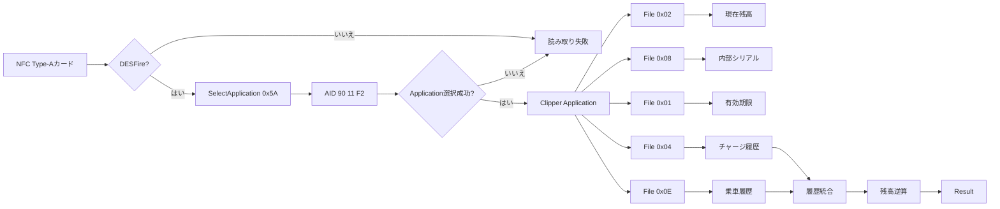
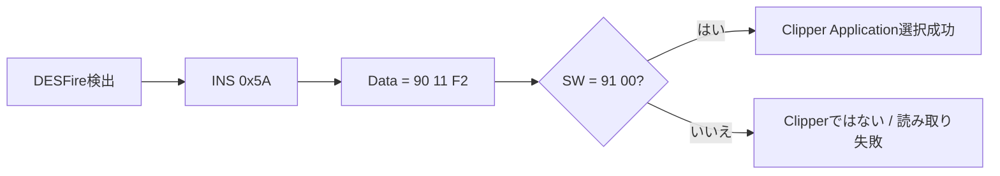
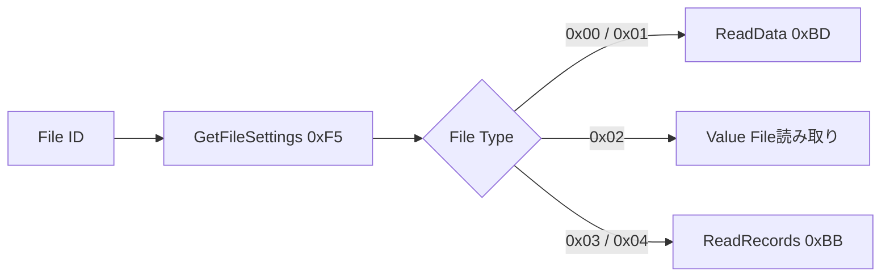
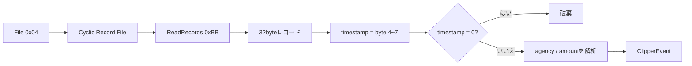
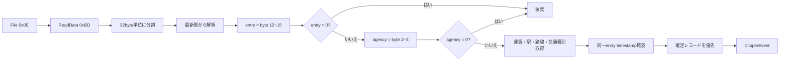
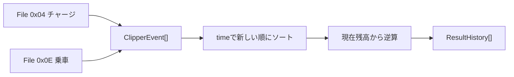
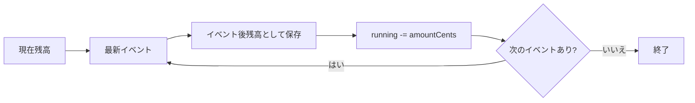
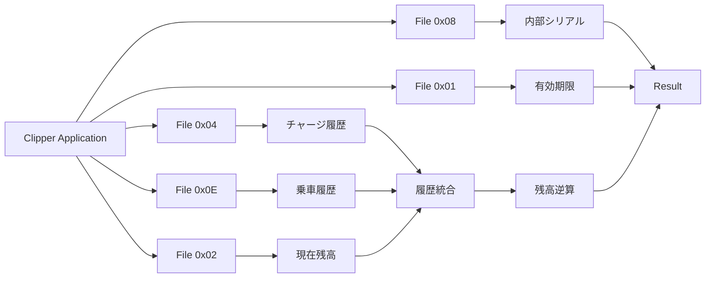

# Clipper

アメリカ・サンフランシスコ湾岸地域で使用される交通系ICカード「Clipper」のICカードフォーマットおよび、現在の `TransitICScanner` における読み取り実装。

ClipperはMIFARE DESFireを使用する交通ICカードシステムで、BART、Muni、Caltrain、AC Transit、VTA、SamTransなど、サンフランシスコ湾岸地域の複数の交通事業者で利用されている。

現在の実装では、CoreNFCから取得したDESFireカードに対してISO 7816ラップされたDESFireコマンドを送信し、Clipper Applicationおよび各Fileを読み取る。

---

# カード内容

| 項目 | 値 |
|---|---|
| NFC種別 | NFC Type-A / ISO 14443 |
| カード種別 | MIFARE DESFire |
| アプリケーション | Clipper |
| Application ID | `0x9011F2` |
| データ形式 | DESFire Application / File |
| 履歴形式 | 32バイト単位 |
| 通貨 | 米ドル (USD) |

Clipper Application IDは `0x9011F2`。

実装では以下の3バイトとして指定する。

```text
90 11 F2
```

---

# Application選択

Clipperカードを検出した後、DESFireの `SelectApplication` コマンドを使用してApplication `0x9011F2` を直接選択する。

使用するDESFireコマンドは以下。

```text
INS = 0x5A
```

Application ID：

```text
90 11 F2
```

したがって、実装上は以下の処理となる。

```text
NFC Type-A / DESFire
        ↓
SelectApplication
INS = 0x5A
Data = 90 11 F2
        ↓
成功
        ↓
Clipper Applicationとして処理
```

現在の実装では `GetApplicationIDs` によってApplication一覧を取得してから `0x9011F2` を検索する方式ではない。

`0x5A` によるApplication選択が成功することを、Clipper Applicationの存在確認として使用する。

実装：

```swift
guard await clipper_command(
    send,
    ins: 0x5A,
    data: clipperAID
) != nil else {
    session.invalidate(errorMessage: "Clipper application not found")
    return
}
```

Application IDは以下の定数として定義されている。

```swift
private let clipperAID = Data([
    0x90,
    0x11,
    0xF2
])
```

---

# DESFire APDU

CoreNFCからは `NFCISO7816APDU` を使用し、DESFire Native CommandをISO 7816形式でラップして送信する。

CLAは `0x90`。

```text
CLA = 0x90
INS = DESFire Native Command
P1  = 0x00
P2  = 0x00
```

例えばApplication選択の場合：

```text
CLA = 90
INS = 5A
P1  = 00
P2  = 00
DATA = 90 11 F2
```

DESFireのレスポンスでは、

```text
SW1 = 0x91
```

を正常なDESFireレスポンスとして扱う。

`SW2 = 0xAF` の場合は追加データが存在するため、次のコマンドとして `0xAF` を送信し、レスポンスを連結する。

```text
DESFire Command
        ↓
SW = 91 AF
        ↓
追加レスポンスあり
        ↓
INS = AF
        ↓
SW = 91 00
        ↓
レスポンスを連結
```

実装では最大32回まで `0xAF` による継続レスポンスを取得する。

---

# File構成

現在の実装で参照しているFileは以下。

| File ID | 内容 | 現在の用途 |
|---|---|---|
| `0x01` | カードメタデータ / 有効期限 | カード有効期限 |
| `0x02` | 残高・最終利用情報 | 現在残高 |
| `0x04` | チャージ履歴 | チャージ履歴 |
| `0x08` | カードシリアル情報 | Clipper内部シリアル |
| `0x0E` | 乗車履歴 | トリップ履歴 |

以下のFileについては現在の実装では解析していない。

| File ID | 状態 |
|---|---|
| `0x05` | 現在未使用 |
| `0x06` | 現在未使用 |
| `0x0F` | 現在未使用 |

したがって、これらのFileについて具体的なデータ構造を確定したものとして扱わない。

---

# File読み取り

Fileの読み取り前に `GetFileSettings` を使用してFile種別を取得する。

DESFireコマンド：

```text
INS = 0xF5
DATA = File ID
```

取得したFile種別に応じて読み取りコマンドを切り替える。

| File Type | 内容 | 使用コマンド |
|---|---|---|
| `0x00` | Standard Data File | `0xBD` |
| `0x01` | Backup Data File | `0xBD` |
| `0x02` | Value File | `0x6C` |
| `0x03` | Linear Record File | `0xBB` |
| `0x04` | Cyclic Record File | `0xBB` |

現在の実装では以下のように処理する。

```text
GetFileSettings
        ↓
File Type取得
        ↓
0x00 / 0x01
        → ReadData (0xBD)

0x03 / 0x04
        → ReadRecords (0xBB)

0x02
        → Value File読み取り (0x6C)
```

読み取りパラメータはStandard Data Fileの場合、

```text
[File ID]
[Offset 3 byte]
[Length 3 byte]
```

として構成する。

全体読み取りではOffsetとLengthをすべて `0x00` とする。

```text
File ID
00 00 00
00 00 00
```

---

# エンディアン

Clipperの数値データは基本的にビッグエンディアンで保存される。

16bit：

```text
value =
    byte[0] << 8
    | byte[1]
```

32bit：

```text
value =
    byte[0] << 24
    | byte[1] << 16
    | byte[2] << 8
    | byte[3]
```

実装：

```swift
private func clipper_be16(
    _ b: [UInt8],
    _ o: Int
) -> UInt16 {
    (UInt16(b[o]) << 8)
    | UInt16(b[o + 1])
}

private func clipper_be32(
    _ b: [UInt8],
    _ o: Int
) -> UInt32 {
    (UInt32(b[o]) << 24)
    | (UInt32(b[o + 1]) << 16)
    | (UInt32(b[o + 2]) << 8)
    | UInt32(b[o + 3])
}
```

---

# 日時データ

Clipperの日時は、1900年1月1日00:00:00 UTCを基準とした秒数として保存される。

```text
timestamp =
    1900-01-01 00:00:00 UTCからの経過秒数
```

UNIX Epochとの差は、

```text
2,208,988,800秒
```

である。

したがって、Swiftの `Date` へ変換する場合：

```text
unixTime =
    timestamp - 2,208,988,800
```

実装：

```swift
private let clipperEpochOffset: TimeInterval =
    2_208_988_800

let date = Date(
    timeIntervalSince1970:
        TimeInterval(seconds) - clipperEpochOffset
)
```

---

# 日時表示

内部データ自体は1900年Epoch基準だが、現在の実装では表示用の `DateComponents` を `America/Los_Angeles` タイムゾーンで生成する。

```swift
private func clipper_calendar() -> Calendar {
    var cal = Calendar(identifier: .gregorian)
    cal.timeZone =
        TimeZone(identifier: "America/Los_Angeles")
        ?? .current
    return cal
}
```

したがって、

```text
カード内 timestamp
        ↓
1900-01-01 UTC基準の秒数
        ↓
Swift Date
        ↓
America/Los_Angeles
        ↓
DateComponents
```

という変換になる。

---

# File 0x02 — 残高

File `0x02` から現在残高を取得する。

| バイト | 内容 |
|---|---|
| `4 ~ 7` | 最終利用時刻 |
| `18 ~ 19` | 現在残高 |
| その他 | 現在の実装では未使用 |

## 残高

`18 ~ 19` を16bit整数として取得する。

ただし、残高は符号付き16bit値として扱う。

```text
raw = byte[18] << 8
    | byte[19]

balanceCents =
    Int16(bitPattern: raw)
```

実装：

```swift
let balanceCents =
    Int(
        Int16(
            bitPattern:
                clipper_be16(bb, 18)
        )
    )
```

このため、マイナス残高にも対応する。

例えば、

```text
FF F1
```

は符号付き16bitでは、

```text
-15
```

となる。

したがって、

```text
balance = -15 cents
        = -$0.15
```

となる。

通常の残高表示はセントを100で割る。

```text
balance =
    balanceCents / 100
```

例えば、

```text
04 D2
```

の場合、

```text
0x04D2 = 1234
```

なので、

```text
$12.34
```

となる。

---

# File 0x02 — 最終利用時刻

`4 ~ 7` の4バイトをビッグエンディアンとして取得する。

```text
timestamp =
    byte[4] << 24
    | byte[5] << 16
    | byte[6] << 8
    | byte[7]
```

変換：

```text
1900-01-01 00:00:00 UTC
        +
timestamp秒
```

ただし、現在の実装ではこのFileから取得した最終利用時刻を `ResultCardInfo` の `validDate` などへ格納してはいない。

現在の `Result` では、履歴の日時は `File 0x04` / `File 0x0E` から取得している。

---

# File 0x08 — Clipper内部シリアル

File `0x08` からClipper内部のカードシリアル番号を取得する。

| バイト | 内容 |
|---|---|
| `1 ~ 4` | シリアル番号 |
| その他 | 現在の実装では未使用 |

`1 ~ 4` をビッグエンディアンの32bit整数として取得する。

```text
serial =
    byte[1] << 24
    | byte[2] << 16
    | byte[3] << 8
    | byte[4]
```

現在の実装では10進数文字列として `ResultCardInfo.serial` に格納する。

```swift
serial =
    String(
        clipper_be32(
            [UInt8](d),
            1
        )
    )
```

---

# NFC UID

Clipper内部シリアルとは別に、CoreNFCから取得したカードUIDを `ResultCardInfo.idm` に使用する。

UIDはバイト列を2桁の16進数文字列として連結する。

```swift
let uid =
    identifier
        .map {
            String(
                format: "%02X",
                $0
            )
        }
        .joined()
```

例えば、

```text
04 A1 B2 C3 D4 E5 F6
```

の場合、

```text
04A1B2C3D4E5F6
```

となる。

したがって、

| ResultCardInfo | 内容 |
|---|---|
| `idm` | NFCカードUID |
| `serial` | File `0x08` の内部シリアル番号 |

となる。

---

# File 0x01 — 有効期限

File `0x01` からカード有効期限を取得する。

| バイト | 内容 |
|---|---|
| `8 ~ 9` | 基準日からの日数 |
| その他 | 現在の実装では未使用 |

`8 ~ 9` をビッグエンディアンの16bit整数として取得する。

```text
days =
    byte[8] << 8
    | byte[9]
```

この値を1900年1月1日からの日数としてDateへ変換する。

```text
date =
    1900-01-01
    +
    days日
```

実装ではまずUTCとして年月日を取得し、その年月日だけを使って端末側のCalendarで `Date` を生成する。

これは「暦日」として保存されている値によるタイムゾーン起因の日付ずれを避けるためである。

```swift
let days =
    clipper_be16(
        [UInt8](d),
        8
    )

let utcDate =
    Date(
        timeIntervalSince1970:
            TimeInterval(days) * 86_400
            - clipperEpochOffset
    )

var utc =
    Calendar(identifier: .gregorian)

utc.timeZone =
    TimeZone(identifier: "UTC")
    ?? .current

let ymd =
    utc.dateComponents(
        [.year, .month, .day],
        from: utcDate
    )

expiry =
    Calendar(
        identifier: .gregorian
    ).date(
        from: ymd
    )
```

取得した有効期限は `issueInfo(... expiry:)` に渡される。

---

# File 0x04 — チャージ履歴

File `0x04` は現在の実機実装では **Cyclic Record File** として扱われる。

そのため、GetFileSettingsでFile Type `0x04` を検出した場合、`ReadRecords (0xBB)` を使用する。

```text
File 0x04
        ↓
GetFileSettings (0xF5)
        ↓
File Type = 0x04
        ↓
ReadRecords (0xBB)
```

チャージ履歴は32バイト単位のレコードとして解析する。

---

# File 0x04 — チャージレコード構造

| バイト | 内容 |
|---|---|
| `2 ~ 3` | 交通事業者ID |
| `4 ~ 7` | チャージ日時 |
| `8 ~ 11` | 端末ID |
| `14 ~ 15` | チャージ金額 |
| その他 | 現在の実装では未使用 |

---

# File 0x04 — 交通事業者ID

`2 ~ 3` の2バイトをビッグエンディアンとして取得する。

```text
agency =
    byte[2] << 8
    | byte[3]
```

---

# File 0x04 — チャージ日時

`4 ~ 7` の4バイトをビッグエンディアンとして取得する。

```text
timestamp =
    byte[4] << 24
    | byte[5] << 16
    | byte[6] << 8
    | byte[7]
```

`timestamp == 0` のレコードは無効として除外する。

```swift
let time =
    clipper_be32(r, 4)

guard time != 0 else {
    continue
}
```

---

# File 0x04 — 端末ID

`8 ~ 11` の4バイトをビッグエンディアンとして取得する。

```text
machineId =
    byte[8] << 24
    | byte[9] << 16
    | byte[10] << 8
    | byte[11]
```

現在の `ClipperEvent` には端末IDを保持するフィールドが存在しないため、読み取り後の `ResultHistory` には格納していない。

---

# File 0x04 — チャージ金額

`14 ~ 15` の2バイトをビッグエンディアンとして取得する。

```text
amountCents =
    byte[14] << 8
    | byte[15]
```

単位はセント。

```text
amount =
    amountCents / 100
```

チャージは履歴上の金額を正数として扱う。

```swift
amountCents:
    +amount
```

---

# File 0x0E — 乗車履歴

File `0x0E` はStandard Data Fileとして扱う。

実機では512バイトのFileとして取得され、32バイト単位で16レコードに分割する。

```text
512 bytes
    ↓
32 bytes × 16 records
```

読み取り：

```text
GetFileSettings
        ↓
File Type = Standard / Backup
        ↓
ReadData (0xBD)
        ↓
File全体
        ↓
32byte単位に分割
```

---

# File 0x0E — レコード構造

| バイト | 内容 |
|---|---|
| `1` | 乗換カウンタ |
| `2 ~ 3` | 交通事業者ID |
| `4 ~ 5` | 乗換関連情報 |
| `6 ~ 7` | 運賃 |
| `8 ~ 9` | Validation / Subscription関連ポインタ |
| `10 ~ 11` | 車両番号 |
| `12 ~ 15` | 入場日時 |
| `16 ~ 19` | 出場日時 |
| `20 ~ 21` | 乗車駅ID |
| `22 ~ 23` | 降車駅ID |
| `24 ~ 27` | 未使用 / 未確認 |
| `28 ~ 29` | 路線ID |
| `30 ~ 31` | 交通種別 |

現在の実装で `ResultHistory` に利用しているのは主に以下。

```text
2 ~ 3    交通事業者
6 ~ 7    運賃
12 ~ 15  入場日時
16 ~ 19  出場日時
20 ~ 21  乗車駅
22 ~ 23  降車駅
28 ~ 29  路線
30 ~ 31  交通種別
```

---

# File 0x0E — 交通事業者ID

`2 ~ 3` をビッグエンディアンとして取得する。

```text
agency =
    byte[2] << 8
    | byte[3]
```

交通事業者IDが `0` のレコードは無効として除外する。

```swift
let agency =
    clipper_be16(r, 2)

guard agency != 0 else {
    continue
}
```

---

# File 0x0E — 運賃

`6 ~ 7` をビッグエンディアンとして取得する。

```text
fareCents =
    byte[6] << 8
    | byte[7]
```

履歴上では運賃を支出として扱うため、`ClipperEvent.amountCents` には負数で格納する。

```swift
amountCents:
    -Int(clipper_be16(r, 6))
```

例えば、

```text
0x011D
```

なら、

```text
285 cents
```

なので、

```text
amountCents = -285
amount = -$2.85
```

となる。

---

# File 0x0E — 入場日時

`12 ~ 15` の4バイトをビッグエンディアンとして取得する。

```text
entryTimestamp =
    byte[12] << 24
    | byte[13] << 16
    | byte[14] << 8
    | byte[15]
```

`entryTimestamp == 0` のレコードは無効として除外する。

```swift
let entry =
    clipper_be32(r, 12)

guard entry != 0 else {
    continue
}
```

---

# File 0x0E — 出場日時

`16 ~ 19` の4バイトをビッグエンディアンとして取得する。

```text
exitTimestamp =
    byte[16] << 24
    | byte[17] << 16
    | byte[18] << 8
    | byte[19]
```

出場日時が `0` の場合がある。

現在の重複排除処理では、

```text
exit != 0
```

を「出場情報を持つ確定済みレコード」として扱う。

---

# File 0x0E — 乗車駅

`20 ~ 21` をビッグエンディアンとして取得する。

```text
stationIn =
    byte[20] << 8
    | byte[21]
```

---

# File 0x0E — 降車駅

`22 ~ 23` をビッグエンディアンとして取得する。

```text
stationOut =
    byte[22] << 8
    | byte[23]
```

---

# File 0x0E — 路線ID

`28 ~ 29` をビッグエンディアンとして取得する。

```text
route =
    byte[28] << 8
    | byte[29]
```

内部的には16bitの `route` として保持する。

`ResultHistory` は路線情報を8bitずつに分けて格納するため、現在の実装では、

```text
lineIn  = routeの上位8bit
lineOut = routeの下位8bit
```

としている。

```swift
lineIn =
    UInt8(e.route >> 8)

lineOut =
    UInt8(truncatingIfNeeded: e.route)
```

---

# File 0x0E — 交通種別

`30 ~ 31` をビッグエンディアンとして取得する。

```text
transport =
    byte[30] << 8
    | byte[31]
```

`ClipperEvent.transport` にそのまま16bit値として保持する。

```swift
transport:
    clipper_be16(r, 30)
```

---

# processType / processType4

`ResultHistory` では、Clipper固有の情報を以下の形式で格納する。

```text
processType
    0x01 = チャージ
    0x02 = 乗車 / トリップ

processType4
    上位16bit = 交通事業者ID
    下位16bit = 交通種別
```

生成：

```swift
processType4 =
    (UInt32(e.agency) << 16)
    | UInt32(e.transport)
```

したがって、

```text
processType4
    = [agency: 16bit][transport: 16bit]
```

という構造になる。

---

# 交通事業者コード

現在のConverterで名称表示に対応している事業者コードは以下。

| コード | 事業者 |
|---|---|
| `0x01` | AC Transit |
| `0x04` | BART |
| `0x06` | Caltrain |
| `0x08` | County Connection |
| `0x0B` | Golden Gate Transit |
| `0x0F` | SamTrans |
| `0x11` | VTA |
| `0x12` | Muni |
| `0x19` | Golden Gate Ferry |
| `0x1B` | SF Bay Ferry |

未対応のコードは空文字列として扱う。

---

# 交通種別コード

現在のConverterでは以下の交通種別を表示対象としている。

| コード | 表示分類 | 備考 |
|---|---|---|
| `0x6F` | 鉄道 | BART / Muni Metroで実機確認 |
| `0x62` | 鉄道 | 現在のConverterで鉄道として処理 |
| `0x61` | バス | 現在のConverterでバスとして処理 |
| `0x75` | バス | 現在のConverterでバスとして処理 |
| `0x77` | バス | Muni / Golden Gate Transitで実機確認 |
| `0x73` | フェリー | 現在のConverterでフェリーとして処理 |

その他のコードは未分類として扱う。

---

# 乗車履歴の重複排除

Clipperでは、タップオン時点の暫定レコードと、タップオフ後に確定したレコードが同じ入場時刻を持って存在する場合がある。

そのため、現在の実装では `entryTimestamp` が同じレコードを重複候補として扱う。

処理順序はFile内の最新側から行う。

```text
File 0x0E
    ↓
32byteレコードへ分割
    ↓
reversed()
    ↓
新しいレコードから解析
```

同一 `entryTimestamp` が存在する場合：

```text
既存レコードなし
        ↓
追加

既存レコードあり
        ↓
既存レコードに出場日時あり？
        ↓
YES
    ↓
新しいレコードを破棄

NO
    ↓
既存レコードを削除
    ↓
新しいレコードを追加
```

実装：

```swift
if let index = parsed.firstIndex(where: {
    $0.event.time == event.time
}) {
    if parsed[index].hasExit {
        continue
    }

    parsed.remove(at: index)
}

parsed.append((
    event: event,
    hasExit: exit != 0
))
```

ここで、

```text
hasExit = exit != 0
```

である。

---

# 履歴の統合

チャージ履歴と乗車履歴は一度 `ClipperEvent` に変換する。

```text
File 0x04
    ↓
チャージイベント

File 0x0E
    ↓
乗車イベント

        ↓

ClipperEvent[]

        ↓

日時でソート

        ↓

ResultHistory[]
```

`ClipperEvent` の構造：

```swift
struct ClipperEvent {
    let time: UInt32
    let kind: UInt8
    let amountCents: Int
    let agency: UInt16
    let transport: UInt16
    let route: UInt16
    let stationIn: UInt16
    let stationOut: UInt16
    let seq: Int
}
```

`kind` は、

```text
0x01 = チャージ
0x02 = 乗車
```

である。

---

# 履歴の並び順

すべてのイベントを日時の新しい順に並べる。

```swift
events.sort {
    $0.time != $1.time
        ? $0.time > $1.time
        : $0.seq < $1.seq
}
```

したがって、

```text
新しいイベント
        ↓
古いイベント
```

の順になる。

同一時刻の場合は `seq` によって順序を決定する。

---

# 残高計算

現在残高はFile `0x02` から取得する。

履歴については現在残高から過去方向へ処理する。

各イベントには「そのイベント後の残高」を設定する。

初期値：

```text
running =
    現在残高
```

最新イベントから順に処理：

```text
現在残高
    ↓
最新イベント
    ↓
そのイベント後の残高として保存
    ↓
イベント金額を逆算
    ↓
次のイベント
```

実装：

```swift
var running = currentBalanceCents

for e in events {
    logs.append(
        ResultHistory(
            processType: e.kind,
            processType4:
                (UInt32(e.agency) << 16)
                | UInt32(e.transport),
            date: clipper_components(e.time),
            balance:
                Double(running) / 100.0,
            amount:
                Double(e.amountCents) / 100.0,
            lineIn:
                UInt8(e.route >> 8),
            stationIn:
                UInt8(
                    truncatingIfNeeded:
                        e.stationIn
                ),
            lineOut:
                UInt8(
                    truncatingIfNeeded:
                        e.route
                ),
            stationOut:
                UInt8(
                    truncatingIfNeeded:
                        e.stationOut
                ),
            transactionId:
                e.seq
        )
    )

    running -= e.amountCents
}
```

重要なのは、チャージは正数、乗車は負数として `amountCents` に格納されていることである。

したがって、

```text
チャージ
amountCents = +2000

乗車
amountCents = -285
```

の場合、

```text
running -= amountCents
```

によって、

```text
チャージ
    → 過去方向へ2000セント減算

乗車
    → 過去方向へ285セント加算
```

となり、過去の残高を逆算できる。

---

# 履歴件数

スキャン設定ではClipperの履歴件数を20件としている。

```swift
historyCount: 20
```

履歴解析後、最終的に最大 `historyCount` 件を返す。

```swift
return Array(
    logs.prefix(
        max(limit, 1)
    )
)
```

したがって通常は20件が上限となる。

---

# ResultHistoryへの変換

チャージ：

```text
processType = 0x01
processType4 =
    agency << 16
amount =
    +チャージ額
```

乗車：

```text
processType = 0x02
processType4 =
    agency << 16 | transport
amount =
    -運賃
```

駅・路線については、

```text
route 16bit
    ↓
lineIn  = 上位8bit
lineOut = 下位8bit

stationIn 16bit
    ↓
stationIn = 下位8bit

stationOut 16bit
    ↓
stationOut = 下位8bit
```

として `ResultHistory` に格納する。

---

# Converter

Clipperの `ResultHistory` は `usClipper_Converter` によって表示用の文字列へ変換される。

```swift
static func history(
    _ history: ResultHistory
) -> DisplayHistory {
    DisplayHistory(
        date: formatDate(history.date),
        processType: convertProcessType(
            history.processType ?? 0,
            UInt32(history.processType4 ?? 0)
        ),
        balance: Double(history.balance)
    )
}
```

日時は、

```text
YYYY/M/D HH:mm
```

形式で表示する。

---

# チャージ表示

`processType == 0x01` の場合はチャージとして表示する。

`processType4` の上位16bitから事業者IDを取得する。

```text
agency =
    (processType4 >> 16) & 0xFFFF
```

表示例：

```text
Charge (BART)
```

---

# 乗車表示

`processType == 0x02` の場合は交通種別と事業者を組み合わせて表示する。

```text
processType4
        ↓
上位16bit
        ↓
agency

下位16bit
        ↓
transport
```

交通種別が判明している場合：

```text
鉄道 (BART)
バス (Muni)
フェリー (SF Bay Ferry)
```

などとして表示する。

交通種別が未分類の場合は、対応する事業者名のみを使用する。

---

# カード情報

スキャン完了時には以下を `Result` に格納する。

```text
balance
isHistory
history
info
converter
isLastHide
description
savedAt
```

現在の実装：

```swift
self.result = Result(
    balance:
        Double(balanceCents) / 100.0,
    isHistory: true,
    history: history,
    info: info,
    converter:
        usClipper.scanOption.converter,
    isLastHide: false,
    description:
        usClipper.scannedDescription,
    savedAt: Date.now
)
```

---

# カード情報取得フロー

```text
Clipper Application
        ↓
File 0x08
        ↓
Clipper内部シリアル取得

File 0x01
        ↓
カード有効期限取得

File 0x02
        ↓
現在残高取得

NFC UID
        ↓
ResultCardInfo.idm
```

---

# 履歴取得フロー

```text
Clipper Application
        ↓
File 0x04
        ↓
チャージ履歴
        ↓
ClipperEvent

Clipper Application
        ↓
File 0x0E
        ↓
乗車履歴
        ↓
重複排除
        ↓
ClipperEvent

        ↓

両方を統合

        ↓

新しい順にソート

        ↓

現在残高から過去方向へ残高を逆算

        ↓

ResultHistory[]
```

---

# カード読み取りフロー



---

# Application選択



---

# File読み取り



---

# チャージ履歴取得



---

# 乗車履歴取得



---

# 履歴統合



---

# 残高逆算



---

# 最終結果



---

# 実装上のFile対応まとめ

| File | File Type | 読み取り | 主なデータ |
|---|---|---|---|
| `0x01` | Standard / Backup | `0xBD` | 有効期限 |
| `0x02` | Standard / Backup等 | `0xBD`等 | 現在残高 |
| `0x04` | Cyclic Record | `0x6C` / `0xBB`系処理 | チャージ履歴 |
| `0x05` | 未使用 | 未使用 | 未解析 |
| `0x06` | 未使用 | 未使用 | 未解析 |
| `0x08` | Standard / Backup | `0xBD` | 内部シリアル |
| `0x0E` | Standard / Backup | `0xBD` | 乗車履歴 |
| `0x0F` | 未使用 | 未使用 | 未解析 |

なお、`clipper_readFile()` はGetFileSettingsのFile Typeに応じて実際の読み取りコマンドを選択するため、上表は現在の実装での論理的な対応を示す。

---

# Clipperスキャン全体

```text
NFC Type-A
    ↓
MIFARE DESFire判定
    ↓
SelectApplication
    INS = 0x5A
    AID = 90 11 F2
    ↓
Clipper Application
    │
    ├── File 0x08
    │      └── Clipper内部シリアル
    │
    ├── File 0x01
    │      └── 有効期限
    │
    ├── File 0x02
    │      └── 現在残高
    │
    ├── File 0x04
    │      └── チャージ履歴
    │
    └── File 0x0E
           └── 乗車履歴
                  ↓
             重複排除
                  ↓
             履歴統合
                  ↓
             残高逆算
                  ↓
             ResultHistory
                  ↓
                 Result
```

---

# ResultCardInfo

現在のClipper実装では以下のようにカード情報を格納する。

| ResultCardInfo | 内容 |
|---|---|
| `idm` | CoreNFCから取得したNFC UID |
| `name` | Clipper |
| `nameShort` | Clipper短縮名 |
| `currencyType` | USD |
| `type` | 空文字列 |
| `serial` | File `0x08` byte `1 ~ 4` の32bit値を10進数化 |
| `version` | `nil` |
| `validDate` | `nil` |
| `issueInfo.expiry` | File `0x01`から取得した有効期限 |

---

# ResultHistory

現在の実装では以下の情報をResultHistoryへ格納する。

| ResultHistory | チャージ | 乗車 |
|---|---|---|
| `processType` | `0x01` | `0x02` |
| `processType4` 上位16bit | 事業者ID | 事業者ID |
| `processType4` 下位16bit | `0` | 交通種別 |
| `date` | チャージ日時 | 入場日時 |
| `balance` | イベント後残高 | イベント後残高 |
| `amount` | 正のチャージ額 | 負の運賃 |
| `lineIn` | `0` | 路線上位8bit |
| `stationIn` | `0` | 乗車駅下位8bit |
| `lineOut` | `0` | 路線下位8bit |
| `stationOut` | `0` | 降車駅下位8bit |
| `transactionId` | `100000 + index` | `200000 + index` |

---

# 参考

- metrodroid / Clipper
  https://github.com/metrodroid/metrodroid/wiki/Clipper

実装上の一次資料としては、現在の `TransitICScanner` における以下の処理を基準とする。

```text
SelectApplication
    INS = 0x5A
    AID = 90 11 F2

GetFileSettings
    INS = 0xF5

ReadData
    INS = 0xBD

ReadRecords
    INS = 0xBB

Value File read
    INS = 0x6C
```

特にFile `0x04` については、現在の実装で実機のFile SettingsからCyclic Record Fileとして判定し、レコード読み取りを行っている点に注意する。