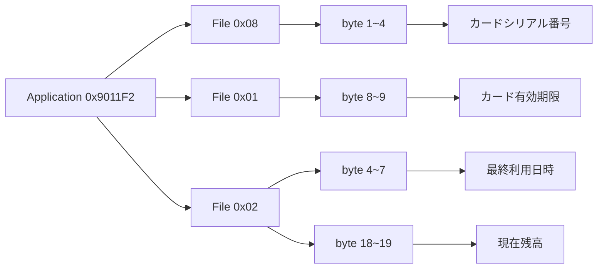
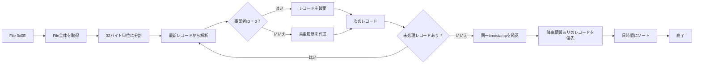
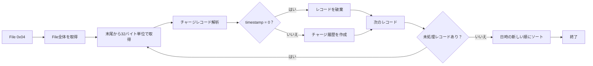
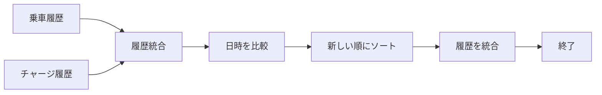
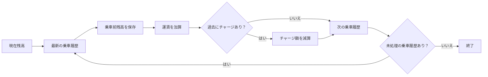
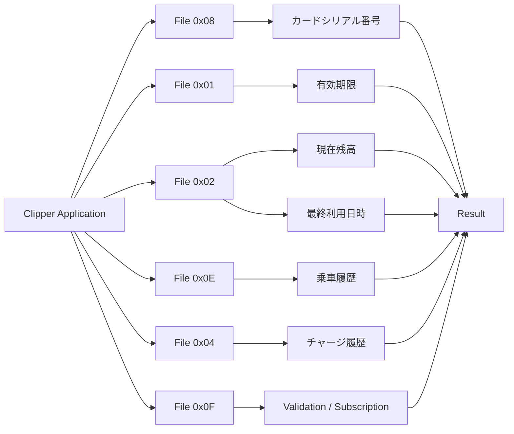

アメリカ・サンフランシスコ湾岸地域の交通系ICカード「Clipper」で使用されるICカードフォーマット。  
ClipperはMIFARE DESFireを使用した交通ICカードシステムで、複数の交通事業者で利用されている。

## カード内容

|||
|--|--|
|**NFC種別**|NFC Type-A / ISO 14443|
|通信方式|MIFARE DESFire|
|アプリケーション|Clipper|
|AID|`0x9011F2`|
|データ形式|DESFire Application / File|
|履歴形式|32バイト固定長データ|
|通貨|米ドル(USD)|

ClipperのデータはすべてApplication ID `0x9011F2`に格納されている。

カード内の数値はビッグエンディアンで保存されている。

日時データは1900年1月1日00:00:00 UTCを基準とした秒数で表現される。


### AID

Clipperアプリケーションとして以下のAIDを使用する。

|優先順位|AID|内容|
|---|---|---|
|1|`90 11 F2`|Clipper Application|

DESFireのApplication IDは3バイトで構成される。

内部実装ではApplication IDを`0x9011F2`として扱う。


### Application

Clipper Applicationには以下のFileが存在する。

|File ID|内容|
|---|---|
|`0x01`|カードメタデータ|
|`0x02`|残高・最終利用時刻|
|`0x04`|チャージ履歴|
|`0x05`|ポインタ情報|
|`0x06`|ポインタ情報|
|`0x08`|カードシリアル番号|
|`0x0E`|乗車履歴|
|`0x0F`|Validation / Subscription情報|

---

# Application選択

DESFireカードを検出した後、Application ID `0x9011F2`を選択する。

T-UnionのISO 7816-4 APDUとは異なり、ClipperではMIFARE DESFireのApplication / File構造を使用する。

Applicationの存在を確認することでClipperカードとして判定する。

```text
Application ID = 0x9011F2
```

Clipperとして判定する条件は、Application `0x9011F2`が存在すること。

---

# カード情報

## File 0x08

カードシリアル番号およびカード種別に関する情報を取得する。

|項目|値|
|---|---|
|File ID|`0x08`|
|レコード形式|固定長データ|
|データ長|32B|

### データ構造

|バイト|内容|
|---|---|
|`0`|固定値 `0x01`|
|`1 ~ 4`|カードシリアル番号|
|`5`|固定値 `0x01`|
|`6 ~ 7`|`0x00`|
|`8`|`0x0F`|
|`9 ~ 31`|`0x00`|

### カードシリアル番号

`1 ~ 4`の4バイトをビッグエンディアンとして結合する。

```text
serial = byte[1] × 256³
       + byte[2] × 256²
       + byte[3] × 256
       + byte[4]
```

この値をカード識別子として使用する。

|ResultCardInfo|値|
|---|---|
|`idm`|カードシリアル番号|
|`serial`|カードシリアル番号|

---

## File 0x01

カードメタデータを取得する。

|項目|値|
|---|---|
|File ID|`0x01`|
|内容|カード有効期限|
|形式|通常データファイル|

### データ構造

|バイト|内容|
|---|---|
|`8 ~ 9`|カード有効期限|
|その他|未確認|

### 有効期限

`8 ~ 9`の2バイトをビッグエンディアンとして整数化する。

```text
expiryDays = byte[8] × 256 + byte[9]
```

1900年1月1日を基準として日数を加算する。

```text
expiryDate = 1900-01-01 + expiryDays
```

---

# 残高データ

## File 0x02

現在の残高および最終利用時刻を取得する。

|項目|値|
|---|---|
|File ID|`0x02`|
|内容|残高・最終利用時刻|
|形式|通常データファイル|

### データ構造

|バイト|内容|
|---|---|
|`4 ~ 7`|最終利用時刻|
|`18 ~ 19`|残高|
|その他|未確認|

### 最終利用時刻

`4 ~ 7`の4バイトをビッグエンディアンとして取得する。

```text
timestamp = byte[4] × 256³
          + byte[5] × 256²
          + byte[6] × 256
          + byte[7]
```

Clipperの日時は1900年1月1日00:00:00 UTCからの秒数として保存される。

```text
date = 1900-01-01 00:00:00 UTC + timestamp秒
```

### 残高

`18 ~ 19`の2バイトをビッグエンディアンとして取得する。

```text
balanceRaw = byte[18] × 256 + byte[19]
```

残高はセント単位で保存されている。

```text
balance = balanceRaw / 100
```

例えば、

```text
0x04D2
```

の場合、

```text
0x04D2 = 1234
```

となるため、

```text
balance = $12.34
```

となる。

---

# チャージ履歴

## File 0x04

チャージ履歴を取得する。

|項目|値|
|---|---|
|File ID|`0x04`|
|内容|チャージ履歴|
|レコード長|32B|
|形式|通常データファイル|

File `0x04`はDESFireのRecord Fileではなく通常データファイルとして扱われる。

そのため、データ全体を取得した後、32バイト単位で分割してレコードとして解析する。

### データ構造

|バイト|内容|
|---|---|
|`2 ~ 3`|交通事業者ID|
|`4 ~ 7`|チャージ日時|
|`8 ~ 11`|端末ID|
|`14 ~ 15`|チャージ金額|
|その他|未確認|

### 交通事業者ID

`2 ~ 3`の2バイトをビッグエンディアンとして取得する。

```text
agency = byte[2] × 256 + byte[3]
```

### チャージ日時

`4 ~ 7`の4バイトをビッグエンディアンとして取得する。

```text
timestamp = byte[4] × 256³
          + byte[5] × 256²
          + byte[6] × 256
          + byte[7]
```

日時は1900年1月1日を基準とする。

```text
date = 1900-01-01 00:00:00 UTC + timestamp秒
```

### 端末ID

`8 ~ 11`の4バイトをビッグエンディアンとして取得する。

```text
machineId = byte[8] × 256³
          + byte[9] × 256²
          + byte[10] × 256
          + byte[11]
```

端末IDは16進数で表示することもできる。

### チャージ金額

`14 ~ 15`の2バイトをビッグエンディアンとして取得する。

```text
amountRaw = byte[14] × 256 + byte[15]
```

単位はセント。

```text
amount = amountRaw / 100
```

### レコード取得

File全体を取得した後、末尾から32バイトずつ逆方向に解析する。

```text
position = data.count - 32

while position > 0
    record = data[position ..< position + 32]
    position -= 32
```

タイムスタンプが`0`のレコードは無効なレコードとして除外する。

解析後、日時の新しい順に並べる。

---

# 乗車履歴

## File 0x0E

乗車履歴を取得する。

|項目|値|
|---|---|
|File ID|`0x0E`|
|内容|乗車履歴|
|レコード長|32B|
|形式|通常データファイル|

File `0x0E`もDESFireのRecord Fileではなく通常データファイルとして扱われる。

そのため、File全体を取得した後、32バイト単位でレコードを解析する。

### データ構造

|バイト|内容|
|---|---|
|`1`|乗換カウンタ|
|`2 ~ 3`|交通事業者ID|
|`4 ~ 5`|乗換関連情報|
|`6 ~ 7`|運賃|
|`8 ~ 9`|Validation / Subscriptionへのポインタ|
|`10 ~ 11`|車両番号|
|`12 ~ 15`|乗車日時|
|`16 ~ 19`|降車日時|
|`20 ~ 21`|乗車駅ID|
|`22 ~ 23`|降車駅ID|
|`24 ~ 27`|未確認|
|`28 ~ 29`|路線ID|
|`30 ~ 31`|交通手段コード|

### 乗換カウンタ

```text
transferCounter = byte[1]
```

### 交通事業者ID

`2 ~ 3`の2バイトをビッグエンディアンとして取得する。

```text
agency = byte[2] × 256 + byte[3]
```

交通事業者IDが`0`の場合、そのレコードは無効として除外する。

### 運賃

`6 ~ 7`の2バイトをビッグエンディアンとして取得する。

```text
fareRaw = byte[6] × 256 + byte[7]
```

単位はセント。

```text
fare = fareRaw / 100
```

### 乗車日時

`12 ~ 15`の4バイトをビッグエンディアンとして取得する。

```text
entryTimestamp = byte[12] × 256³
               + byte[13] × 256²
               + byte[14] × 256
               + byte[15]
```

Clipperの時間形式へ変換する。

```text
entryDate = 1900-01-01 00:00:00 UTC + entryTimestamp秒
```

### 降車日時

`16 ~ 19`の4バイトをビッグエンディアンとして取得する。

```text
exitTimestamp = byte[16] × 256³
              + byte[17] × 256²
              + byte[18] × 256
              + byte[19]
```

降車データが存在しない場合もある。

その場合は降車日時を未設定として扱う。

### 乗車駅

`20 ~ 21`の2バイトをビッグエンディアンとして取得する。

```text
from = byte[20] × 256 + byte[21]
```

### 降車駅

`22 ~ 23`の2バイトをビッグエンディアンとして取得する。

```text
to = byte[22] × 256 + byte[23]
```

降車処理を必要としない交通機関では、降車駅が存在しない場合がある。

### 路線ID

`28 ~ 29`の2バイトをビッグエンディアンとして取得する。

```text
route = byte[28] × 256 + byte[29]
```

### 交通手段コード

`30 ~ 31`の2バイトをビッグエンディアンとして取得する。

```text
transportCode = byte[30] × 256 + byte[31]
```

現在、具体的なコード一覧は未確認。

---

# 乗車履歴の重複排除

同一の乗車について、入場時の一時的なレコードと、降車情報を含む更新後のレコードが存在する場合がある。

同一の乗車時刻を持つレコードが複数存在する場合、降車日時を持つレコードを優先する。

### 処理

```text
同一timestampのレコードを検索
        ↓
既存レコードなし
        ↓
新しいレコードを追加

既存レコードあり
        ↓
既存レコードに降車日時あり？
        ↓
はい → 新しいレコードを破棄
        ↓
いいえ
        ↓
既存レコードを削除
        ↓
新しいレコードを追加
```

最後に日時の順番でソートする。

---

# Validation / Subscription

## File 0x0F

ValidationおよびSubscriptionに関する情報を取得する。

|項目|値|
|---|---|
|File ID|`0x0F`|
|内容|Validation / Subscription|
|レコード長|32B|
|形式|通常データファイル|

Validationレコードは32バイト単位で保存される。

`2 ~ 3`バイトによってレコード形式を判定する。

---

## Format 0x7000

|バイト|内容|
|---|---|
|`0 ~ 1`|`0x2000`または`0x20F0`|
|`2 ~ 3`|`0x7000`|
|`4 ~ 5`|日付|
|`6 ~ 7`|`0xFF`|
|`8 ~ 11`|乗車日時|
|`12 ~ 13`|乗車駅ID|
|`14 ~ 31`|`0xFF`|

### 有効期限

`4 ~ 5`の2バイトは1900年1月1日を基準とした日数。

この値に1806日を加えた値が有効期限に相当する。

```text
expiryDate = 1900-01-01 + date + 1806日
```

### 乗車日時

`8 ~ 11`の4バイトをビッグエンディアンとして取得する。

```text
timestamp = byte[8] × 256³
          + byte[9] × 256²
          + byte[10] × 256
          + byte[11]
```

### 乗車駅

`12 ~ 13`の2バイトをビッグエンディアンとして取得する。

```text
station = byte[12] × 256 + byte[13]
```

---

## Format 0x8000

|バイト|内容|
|---|---|
|`0 ~ 1`|`0x2000`|
|`2 ~ 3`|`0x3000`|
|`4 ~ 5`|将来の日付|
|`14 ~ 15`|過去の日付|
|その他|未確認|

`4 ~ 5`および`14 ~ 15`は1900年1月1日を基準とした日数として保存されている。

その他のフィールドについては、現時点では具体的な意味を確定しない。


# File 0x05

File `0x05`はポインタ情報を保持していると考えられる。

|File ID|内容|
|---|---|
|`0x05`|ポインタ情報|

具体的なデータ構造は未確認。

現時点ではカード残高・カード番号・履歴の解析には使用しない。


# File 0x06

File `0x06`もポインタ情報を保持していると考えられる。

|File ID|内容|
|---|---|
|`0x06`|ポインタ情報|

具体的なデータ構造は未確認。

現時点ではカード残高・カード番号・履歴の解析には使用しない。


# 日時データ

Clipperでは日時を1900年1月1日00:00:00 UTCからの秒数として保存する。

```text
timestamp = 1900-01-01 00:00:00 UTCからの秒数
```

日時への変換：

```text
date = 1900-01-01 00:00:00 UTC + timestamp秒
```

カード内の数値はビッグエンディアンで保存される。


# 残高計算

File `0x02`には現在のカード残高が保存されている。

File `0x0E`の乗車履歴には運賃が保存されている。

File `0x04`にはチャージ履歴が保存されている。

そのため、履歴ごとの残高を表示する場合は、現在残高から過去方向へ運賃・チャージを逆算する。

### 計算方法

1. File `0x02`から現在残高を取得
2. File `0x0E`から乗車履歴を取得
3. File `0x04`からチャージ履歴を取得
4. 両方を日時順に並べる
5. 最新の履歴から過去方向へ処理する
6. チャージを過去方向へ戻す場合は残高からチャージ額を減算
7. 乗車を過去方向へ戻す場合は残高に運賃を加算
8. 各乗車履歴の残高を保存する

```text
現在残高
    ↓
最新の乗車履歴
    ↓
乗車前残高を保存
    ↓
運賃を加算して過去へ戻る
    ↓
チャージ履歴があればチャージ額を減算
    ↓
次の乗車履歴
    ↓
繰り返し
```

実装上は、日時の新しい順に並んだ乗車履歴とチャージ履歴を使用する。


# 履歴データ

Clipperの履歴は主に以下の2種類に分類される。

|File ID|内容|
|---|---|
|`0x0E`|乗車履歴|
|`0x04`|チャージ履歴|

乗車履歴は32バイト単位、チャージ履歴も32バイト単位で保存される。

### 乗車履歴

|項目|データ|
|---|---|
|日時|`0x0C ~ 0x0F`|
|降車日時|`0x10 ~ 0x13`|
|運賃|`0x06 ~ 0x07`|
|事業者|`0x02 ~ 0x03`|
|乗車駅|`0x14 ~ 0x15`|
|降車駅|`0x16 ~ 0x17`|
|路線|`0x1C ~ 0x1D`|

### チャージ履歴

|項目|データ|
|---|---|
|日時|`0x04 ~ 0x07`|
|事業者|`0x02 ~ 0x03`|
|端末ID|`0x08 ~ 0x0B`|
|チャージ額|`0x0E ~ 0x0F`|


# フロー

## カード読み取り

```mermaid
graph LR;
    A[開始] --> B["NFC Type-Aカード取得"];
    B --> C{"DESFireカード？"};
    C -- いいえ --> Z["読み取り失敗"];
    C -- はい --> D["Application一覧取得"];
    D --> E["Application 0x9011F2を検索"];
    E --> F{"Application存在？"};
    F -- いいえ --> Z;
    F -- はい --> G["Clipper Application選択"];
    G --> H["File一覧取得"];
    H --> I["File 0x08取得"];
    I --> J["カードシリアル番号取得"];
    J --> K["File 0x02取得"];
    K --> L["残高・最終利用日時取得"];
    L --> M["File 0x04取得"];
    M --> N["チャージ履歴解析"];
    N --> O["File 0x0E取得"];
    O --> P["乗車履歴解析"];
    P --> Q["File 0x0F取得"];
    Q --> R["Validation / Subscription解析"];
    R --> S["履歴統合"];
    S --> T["残高計算"];
    T --> U["カード情報・残高・履歴をResultへ格納"];
    U --> V[終了];
```



***

## Application選択


***

## カード情報取得



***

## 乗車履歴取得



***

## チャージ履歴取得



***

## 乗車履歴解析


***

## チャージ履歴解析


***

## 履歴統合



***

## 残高計算



***

## 最終結果



## 参考文献
- [metrodroid](https://github.com/metrodroid/metrodroid/wiki/Clipper)