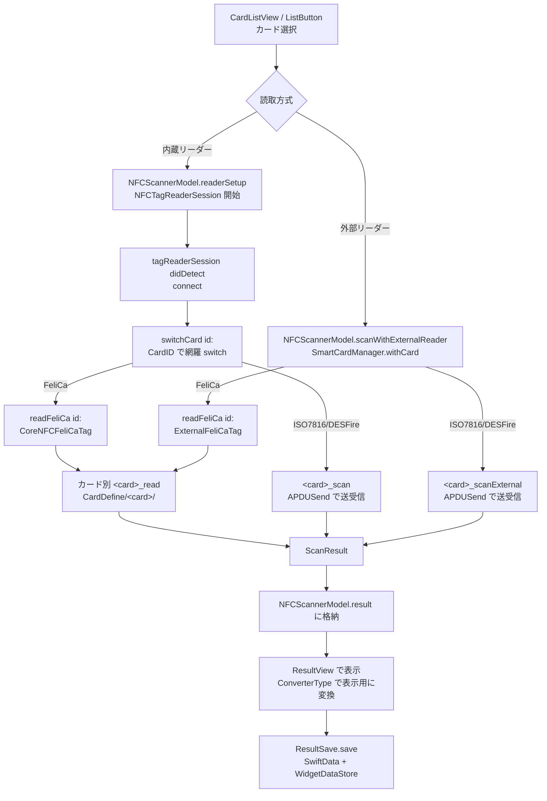

# ファイル構成とアーキテクチャ

このドキュメントは、リポジトリのファイル構成と、各ファイルの役割・実装意図をまとめたものです。
人間が全体像をつかむため、また LLM が「どのファイルを読む・触るべきか」を判断するために使います。

- 対象：`main` から派生した `feature/ios/refactor-92`（Issue #92）時点の構成
- パスはリポジトリルートからの相対パス。iOS ソースは `iOS/TransitICScanner/` 配下
- カード定義の追加・変更ルールは [`CardDefine/AGENTS.md`](../../iOS/TransitICScanner/TransitICScanner/CardDefine/AGENTS.md) が正。このドキュメントと食い違う場合は AGENTS.md を優先する
- ファイルを追加・移動・改名したら、このドキュメントも更新する

---

## 1. 3行でわかる全体像

1. ユーザーが**カード一覧**からカードを選ぶと、`ScanOption`（カード定義）に従って **CoreNFC（内蔵リーダー）** か **CryptoTokenKit（外部リーダー）** で読み取る
2. 読取処理はカードごとに `CardDefine/<カードID>/` に実装され、結果は共通の `ScanResult` に変換されて**結果画面**に表示される
3. 結果は **SwiftData（＋CloudKit 同期）** に保存され、残高は App Group 経由で **Widget** と **Apple Watch** からも見られる

---

## 2. ディレクトリ構成

```text
TransitICScanner/
├── README.md / README_en.md     … 対応カード一覧・対応OS（日本語 / 英語）
├── doc/
│   ├── cards/<カードID>.md      … カードごとの仕様書（サービスコード、ブロック形式など）
│   └── dev/                     … 開発ドキュメント（このファイルを含む）
├── resource/card/<カードID>/    … カード券面画像の元データ（アプリには Assets.xcassets 経由で取り込む）
├── script/                      … 補助スクリプト（xcstrings の簡体字→繁体字変換）
├── AppIcon.psd                  … アプリアイコンの元データ
├── package.json / .cz-adapter.js … コミットメッセージ用 Commitizen 設定
└── iOS/TransitICScanner/
    ├── TransitICScanner.xcodeproj/
    ├── TransitICScanner/                 … アプリ本体（iOS / Mac Catalyst）※一部を Widget・Watch と共有
    │   ├── TransitICScannerApp.swift     … エントリポイント
    │   ├── ContentView.swift             … タブ構成と起動時セットアップ
    │   ├── CardDefine/                   … ★カード定義と読取処理（最重要）
    │   ├── Scan/                         … 読取の基盤（モデル・CoreNFC・外部リーダー・FeliCa抽象化・一覧UI）
    │   ├── Result/                       … 読取結果のモデル・表示・保存
    │   ├── Setting/                      … 設定画面
    │   ├── Ads/                          … 広告（Google Mobile Ads）
    │   ├── FirstLookPopup/               … 初回起動時の権限説明・TipKit
    │   ├── NFCTool/                      … 開発用ツール（読取ログ閲覧）
    │   ├── Debug/                        … デバッグ設定・ダミーデータ
    │   ├── Localize/                     … 文字列カタログ（.xcstrings）
    │   ├── Utility/                      … 共通ユーティリティ（ログ）
    │   ├── Config/                       … xcconfig（DEV / BETA / REL）
    │   └── Assets.xcassets, AppIcon/, Info.plist, *.entitlements, PrivacyInfo.xcprivacy, *.storekit
    ├── CardBalanceWidget/                … ホーム画面 Widget（Widget Extension）
    ├── TransitICScanner_Watch Watch App/ … Apple Watch アプリ（保存済みデータの閲覧のみ）
    └── CardBalance/                      … ⚠ どのターゲットにも属していない Xcode テンプレートの残骸（§9）
```

---

## 3. ターゲット・ビルド構成

### 3.1 ターゲット

| ターゲット | ソースフォルダ | 内容 |
|---|---|---|
| `TransitICScanner` | `TransitICScanner/` | アプリ本体。iOS と Mac Catalyst（Mac では外部リーダーが必須） |
| `CardBalanceWidgetExtension` | `CardBalanceWidget/` | 残高を表示する Widget（小サイズとリストの2種類） |
| `TransitICScanner_Watch Watch App` | `TransitICScanner_Watch Watch App/` | iPhone で保存したカードを CloudKit 経由で閲覧する |

### 3.2 ファイルとターゲットの対応（重要）

プロジェクトは **Xcode のフォルダ同期（`PBXFileSystemSynchronizedRootGroup`）** を使っています。

- フォルダにファイルを置くだけで、そのフォルダを持つターゲットのビルド対象になります（`project.pbxproj` の編集は不要）
- **他のターゲットのフォルダにあるファイルを共有する方法は2通りあります**
  - フォルダ同期の `membershipExceptions` に列挙する（新しく共有するときはこちらを使う。例：`Utility/Log.swift`）
  - 個別のファイル参照（`PBXFileReference`、ID が `AB0000…` で始まるもの）を各ターゲットの Sources に登録する（`ResultSave.swift`、`Storage.swift`、`Area.swift` などの古い共有方法）

ビルド時に実際に共有されているファイル：

| ファイル（`TransitICScanner/` 以下） | Widget | Watch |
|---|:-:|:-:|
| `Result/BalanceFormat.swift` | ✅ | ✅ |
| `Result/SaveData/Storage.swift` | ✅ | ✅ |
| `Utility/Log.swift` | ✅ | ✅ |
| `CardDefine/Area.swift` | ✅ | ✅ |
| `Result/ResultModel.swift` | | ✅ |
| `Result/SaveData/ResultSave.swift` | | ✅ |
| `Localize/localize.swift` | | ✅ |
| `Localize/*.xcstrings` | ✅（リソースとして） | ✅ |
| `Assets.xcassets`, `AppIcon/*` | ✅ | ✅（Watch 用アイコンのみ） |

共有ファイルを変更したら、Widget と Watch のスキームもビルドして確認してください。

逆方向として、`CardBalanceWidget/BalanceWidgetModel.swift` はアプリ本体からも使われます（保存時に Widget 用データを書き込むため）。

Watch とアプリで同じファイルを使う箇所は `#if os(watchOS)` で分岐しています（例：`ScanOption.pollingOption` の型、`ResultSave` の Widget 関連処理）。

### 3.3 ビルド環境（DEV / BETA / REL）

| スキーム | 構成 | xcconfig | `APP_ENVIRONMENT` | 表示されるカード | 広告 |
|---|---|---|---|---|---|
| Dev / Watch_Dev | Debug | `devConfig.xcconfig` | `DEV` | `devCards + featureCards + relCards` | テスト用広告ID |
| Beta / Watch_Beta | Beta | `betaConfig.xcconfig` | `BETA` | `relCards`（テストカードを有効にすると `featureCards` も） | 本番 |
| Release / Watch_Rel | Release | `relConfig.xcconfig` | `REL` | `relCards` | 本番 |
| Widget | — | — | （値なし → REL 扱い） | — | — |

- `APP_ENVIRONMENT` → Info.plist の `AppEnvironment` → `AppEnvironment.current`（`Result/SaveData/Storage.swift`）として参照します
- Debug と Beta の構成では `DEBUG` フラグが有効なため、`Log.debug` が出力されます

### 3.4 Git 管理外の必須ファイル

`TransitICScanner/Ads/env.swift` は `.gitignore` の対象です。クローン直後は自分で作成する必要があります。

```swift
let NativeUnitID = ""   // AdMob ネイティブ広告ユニットID（本番）
let bannerUnitID = ""   // AdMob バナー広告ユニットID（本番）
```

---

## 4. アーキテクチャ

### 4.1 読み取りの流れ



### 4.2 設計方針

| 方針 | 理由 | 関連ファイル |
|---|---|---|
| **カードは `CardID` enum で識別し、分岐は網羅的な `switch` で書く** | カードを追加したときの分岐漏れをコンパイルエラーで検出するため。rawValue は保存データやローカライズキーにも使われるので変更しない | `Scan/CardModel.swift`, `CardDefine/ScannerBranch.swift` |
| **FeliCa の読み取りは `FeliCaTagReading` に対して1つだけ実装する** | 内蔵リーダーと外部リーダーで同じ解析処理を通し、解析処理の重複や挙動のずれを防ぐため。外部リーダーは PC/SC の疑似 APDU（`FF A4` / `FF B0`）を、CoreNFC と同じ `readWithoutEncryption` の形に変換する | `Scan/FeliCa/FeliCaTagReading.swift` |
| **ISO7816 / DESFire カードは `APDUSend` クロージャで送受信を抽象化する** | CoreNFC（`NFCISO7816Tag` / `NFCMiFareTag`）と CryptoTokenKit（`TKSmartCard`）の違いを吸収するため | `Scan/CardModel.swift`（`APDUSend`）, 各カードの `_scan` / `_scanExternal` |
| **読み取った値（生データ）と表示用の値を分ける** | 保存データにはカードから読んだ値だけを残し、取引種別名などは表示時に Converter で変換する。変換ロジックを直せば過去の保存データの表示も直る | `Result/ResultModel.swift`, `CardDefine/ConverterType.swift`, `*Converter.swift` |
| **読めなかった値を 0 や空として扱わない** | 誤った残高を表示しないため。読取に失敗したら `nil` を返し、セッションをエラーで終了する | 各カードの `_read` |
| **保存先はプロセス起動時に一度だけ決める** | ModelContainer と Widget の参照先が起動中に食い違うのを防ぐため | `Result/SaveData/Storage.swift`（`StorageConfig`） |
| **履歴の `transactionId` はカード内で一意かつ再読取しても同じ値にする** | 保存時に `transactionId` で重複を除くため。連番がないカードは `ResultHistory.makeTransactionID` を使う。並び順の番号や固定値を使うと履歴が保存されない | `Result/ResultModel.swift`, `Result/SaveData/ResultSave.swift` |
| **iPhone の画面遷移は `NavigationStack` のパスで行う** | compact 幅で `NavigationSplitView` を差し替えたり `preferredCompactColumn` で遷移したりすると、アニメーションが出ない・遷移先が空になる不具合があったため。分割表示は regular 幅（iPad・Mac）だけで使う | `Scan/List/CardListView.swift`, `Result/SaveData/SavedListView.swift` |
| **ログは `Log.debug` / `Log.error` を使い、`print` は使わない** | リリースビルドで IDm や履歴の生データを出力しないため | `Utility/Log.swift` |
| **表示文字列はローカライズキーで持つ** | 多言語（現在は en / ja / zh-Hans / zh-Hant）に対応するため。カード名・地域・発行者などもキー（例：`issue.jp.miyazaki.city.sendai`）で保存する | `Localize/Localizable.xcstrings`, `Localize/localize.swift` |

### 4.3 主要な型

| 型 | 定義場所 | 役割 |
|---|---|---|
| `CardInfo` | `Scan/CardModel.swift` | カード一覧の1項目（名前・地域・検索語・サンプル結果・`ScanOption`） |
| `ScanOption` | `Scan/CardModel.swift` | 読取設定（`id: CardID`、読取方式、ポーリング種別、FeliCa システムコード、履歴件数、通貨、Converter） |
| `CardID` | `Scan/CardModel.swift` | カードの識別子。読取処理の分岐に使う |
| `ScanType` / `ScanReaderSource` | `Scan/CardModel.swift` | 読取方式（NFC / スクレイピング / 外部リーダー）と、内蔵・外部リーダーの選択 |
| `APDUSend` | `Scan/CardModel.swift` | リーダーに依存しない APDU 送受信クロージャ |
| `FeliCaTagReading` | `Scan/FeliCa/FeliCaTagReading.swift` | FeliCa の読み取りの抽象（実装は `CoreNFCFeliCaTag` と `ExternalFeliCaTag`） |
| `NFCScannerModel` | `Scan/CoreNFC/NFCScanner.swift` | 読取セッションの管理と `result` の公開。各カードの読取処理はこの型の extension として実装する |
| `SmartCardManager` | `Scan/ExternalSmartCardReader/SmartCardManager.swift` | CryptoTokenKit による外部リーダーの検出・選択・接続 |
| `ScanResult` | `Result/ResultModel.swift` | 読取結果（残高、履歴、カード情報、Converter、ログ） |
| `ResultHistory` / `ResultCardInfo` / `IssueInfo` | `Result/ResultModel.swift` | 保存される生データ |
| `DisplayHistory` / `DisplayCardInfo` | `Result/ResultModel.swift` | 表示用に変換したデータ |
| `ConverterType` | `CardDefine/ConverterType.swift` | 生データ → 表示データの変換先を選ぶ enum（rawValue は保存データの `converterTypeRaw` に使う） |
| `SavedCard` / `SavedHistory` | `Result/SaveData/ResultSave.swift` | SwiftData のモデル（CloudKit で同期） |
| `AreaType` / `RegionType` / `CurrencyType` | `CardDefine/Area.swift` | 国・地域区分と通貨 |
| `AppEnvironment` / `StorageConfig` | `Result/SaveData/Storage.swift` | ビルド環境、App Group・CloudKit コンテナの決定 |
| `WidgetDataStore` / `BalanceWidgetModel` | `CardBalanceWidget/BalanceWidgetModel.swift` | Widget に表示するデータの読み書き |

---

## 5. ファイル別の役割と実装意図

### 5.1 エントリポイント・全体

| ファイル | 役割 | 実装意図・メモ |
|---|---|---|
| `TransitICScanner/TransitICScannerApp.swift` | `@main`。`ModelContainer` の作成、環境オブジェクトの注入 | 保存先を確定させるため、`ModelContainer` を作る前にデバッグ用ストレージの設定を確定させる。`ModelContainer` を作れない場合は `makeContainerWithFallback()` で iCloud 同期なし → メモリ上の一時保存に切り替えて起動を続ける。AdMob の初期化は `AdConsentManager` が同意取得後に行う |
| `TransitICScanner/ContentView.swift` | タブ（カード一覧 / 履歴 / ツール(DEV のみ) / 設定）、初回権限モーダル、`setup()`、保存エラーのアラート | `setup()` で環境ごとに一覧に出すカード・課金ID・広告IDを切り替える。ATT は説明画面を完了済みで未決定の場合のみここで要求する。初回の説明画面の後に広告の同意取得（UMP）を行い、購入状態の監視（`PurchaseManager`）を始める |
| `TransitICScanner/SquareIconView.swift` | 角丸アイコンの共通ビュー | |
| `TransitICScanner/Info.plist` | `AppEnvironment`、AdMob の App ID、FeliCa システムコード一覧、ISO7816 AID 一覧 | **CoreNFC で読むシステムコード / AID はここに登録が必要**（カード追加時に忘れやすい） |
| `TransitICScanner/TransitICScanner.entitlements` | NFC、CloudKit（本番 / debug）、App Group（本番 / debug）、スマートカード | App Group の**先頭が本番用**であることに依存している（SwiftData の保存先） |
| `TransitICScanner/PrivacyInfo.xcprivacy` | プライバシーマニフェスト（UserDefaults：CA92.1 / 1C8F.1） | トラッキングの申告は広告 SDK 側のマニフェストが担う |
| `TransitICScanner/StoreKitConf.storekit`, `Debug/StoreKitTest.storekit` | 広告削除の課金のローカルテスト設定 | |

### 5.2 `CardDefine/` — カード定義と読取処理

**カード1枚分のファイル構成**（例：`jpOKICA/`）

| ファイル | 内容 |
|---|---|
| `<カードID>.swift` | ① `let <カードID> = CardInfo(...)`：一覧表示・検索・サンプル・`ScanOption`<br>② `extension NFCScannerModel` の読取処理：FeliCa なら `<id>_read(_ felicaTag: any FeliCaTagReading) async -> ScanResult?`、ISO7816 なら `<id>_scan(tag, session)` と `<id>_scanExternal(using:)` |
| `<カードID>Converter.swift` | `enum <id>_Converter`。`history(_:) -> DisplayHistory` と `cardInfo(_:) -> DisplayCardInfo`。取引種別コード → ローカライズ文字列の変換など |

**共通ファイル**

| ファイル | 役割 | 実装意図・メモ |
|---|---|---|
| `AGENTS.md` | カード実装ルール（仕様根拠、登録箇所、禁止事項） | **カードを追加・変更する前に必ず読む** |
| `ScannerBranch.swift` | `relCards` / `featureCards` / `devCards`（一覧に出すカード）、`switchCard(id:)`、`scanWithExternalReader`、`readFeliCa(id:)` | 読取方式ごとの振り分けを1か所に集めている。FeliCa のカードは `readFeliCa` に1行追加するだけで、内蔵リーダーと外部リーダーの両方に対応する |
| `ConverterType.swift` | `ConverterType` enum と、各 Converter への振り分け。`Data.toIntReversed` | SAPICA などの互換カードは `.jpIC` の Converter を共有する（`CardID` と `ConverterType` は1対1ではない） |
| `Area.swift` | `AreaType`（国）、`RegionType`（地域区分）、`regionLists`、`CurrencyType`（通貨と表示書式） | Watch とも共有 |
| `cardDesignList.swift` | 券面画像の一覧（Converter と券種から画像名を引く） | `Scan/List/CardImage.swift` の `getCardImageName` から使う |
| `prefSort.swift` | 日本の都道府県の並び順 | 一覧の地域ソートに使う |

**カード一覧**（`CardID` 順）

| CardID | 方式 | 公開状態 | 備考 |
|---|---|---|---|
| `jpIC`, `jpIC_SAPICA`, `jpIC_IruCa`, `jpIC_icsca` | FeliCa | rel | 実装は `jpIC/` で共有。システムコードと発行情報だけが異なる |
| `cnTunion` | ISO7816 | rel | 4ファイルに分割：`cnTunion.swift`（読取フロー）、`+APDU`、`+FCI`（FCI・管理情報）、`+Records`（残高・取引記録）。`cnTunion_cards.swift` は IIN から発行都市・発行者を引く表 |
| `hkOctopus` | FeliCa | rel | 残高は 0.1HKD 単位で、デポジット HK$50 を含む |
| `krOneCard` | ISO7816 | rel | KS X 6924 |
| `twICash` | ISO7816 | rel | |
| `jpNplus` | FeliCa | rel | |
| `twEasyCard_old` | スクレイピング | rel | NFC 読取はない。Web ページを読み込む `scrapingView` で取得する |
| `usClipper` | DESFire（`NFCMiFareTag` / ISO7816） | rel | |
| `jpDoCard` | FeliCa | rel | 解析用の詳細ログ（`fullLog`）を結果に付ける |
| `jpOKICA` | FeliCa | rel | 残高は最新の履歴から取る |
| `jpRapica` | FeliCa | rel | 履歴に年がないため、属性情報の日時を基準に年を補完する |
| `idKMT` | FeliCa | dev | KAI Commuter（ジャカルタ）。Issue #77 |
| `spFlashPay` | — | dev | 読取処理は未実装（分岐では `undefinedName` エラーを返す） |

### 5.3 `Scan/` — 読取の基盤とカード一覧 UI

| ファイル | 役割 | 実装意図・メモ |
|---|---|---|
| `CardModel.swift` | `CardInfo`、`ScanOption`、`CardID`、`ScanType`、`ScanReaderSource`、`APDUSend`、サンプル用日付、検索処理 | カード定義のデータ構造をすべてここに集めている |
| `CoreNFC/NFCScanner.swift` | `NFCScannerModel`（`NFCTagReaderSessionDelegate`）。セッションの開始・終了、タグの接続、エラーの公開、`completeScan`。冒頭のコメントに読み取りの流れを記載 | 読取処理本体は `switchCard` 以降の各カードに任せ、このファイルはセッション管理に専念する。読取成功時は必ず `completeScan` を使う（完了メッセージの表示とセッション終了を揃えるため）。タイムアウトなどシステム側の終了は `scanError` で一覧画面に通知する |
| `FeliCa/FeliCaTagReading.swift` | `FeliCaTagReading` プロトコル、`CoreNFCFeliCaTag`、`ExternalFeliCaTag` | ブロックリストは2バイト形式のみ対応。外部リーダーは1ブロックずつ読む |
| `ExternalSmartCardReader/SmartCardManager.swift` | 外部リーダーの一覧と監視、リーダー選択、`withCard`（接続〜切断）、`apduSender(for:)` | `@MainActor`。Mac（Catalyst）・iPad で CCID 互換リーダーを使う |
| `ExternalSmartCardReader/README.md` | 外部リーダー対応のメモ | |
| `List/CardListView.swift` | スキャンタブ（現在地のカード、地域一覧、検索）と、結果画面への画面遷移 | iPad・Mac は `NavigationSplitView`（詳細列に結果）、iPhone は `NavigationStack` のパス `compactPath`（一覧 → 地域 → 結果）でプッシュ遷移する。遷移は `openRegion` / `showResult` に集約している |
| `List/CardRegionView.swift` | 地域ごとのカード一覧と並び替え | |
| `List/ListSupportViews.swift` | 未選択時の案内表示、iPhone Duo のヒンジ検出 | |
| `List/ListButton.swift` | 一覧の行（`CardListRow`）と読取ボタン（`ScanningButton`） | 読取の起点。結果は `onResult` で呼び出し元に渡し、画面遷移は CardList が行う。**シミュレータでは NFC の代わりにカード定義のサンプル結果を返す**（画面遷移の確認用） |
| `List/ScanReaderPicker.swift` | 内蔵リーダーと外部リーダーの選択 UI | |
| `List/CardImage.swift` | 券面画像の表示と画像名の解決 | |
| `List/getCountry.swift` | 位置情報から現在の国を判定し、一覧の初期表示地域に使う | `CLGeocoder` は iOS 26 で非推奨（警告あり）。MapKit への移行が今後必要 |

### 5.4 `Result/` — 結果のモデル・表示・保存

| ファイル | 役割 | 実装意図・メモ |
|---|---|---|
| `ResultModel.swift` | `ScanResult` と、生データ / 表示用データの型、`ResultHistory.makeTransactionID` | `ScanResult` は Swift 標準の `Result` との衝突を避けるための名前。カード内に取引の連番がない場合は `makeTransactionID`（日時・種別・残高から作る）で `transactionId` を作る |
| `ResultView.swift` | 結果画面（残高、カード情報、発行情報、履歴、保存ボタン） | 新しく読み取った結果（`scandata`）は閉じるときに `ResultSave.save` で保存する。保存済みカードの表示では、表示名・券面の変更だけを `ResultSave.updateUserData` で保存し、残高や履歴は書き換えない |
| `BalanceFormat.swift` | `Double` の残高表示書式 | Widget・Watch と共有 |
| `SaveData/Storage.swift` | `AppEnvironment`、`StorageConfig`（App Group・CloudKit コンテナ・デバッグ用ストレージの切り替え） | 全ターゲットで共有。デバッグ用ストレージの設定はリリース用 App Group に保存し、Widget からも読めるようにしている |
| `SaveData/ResultSave.swift` | `CloudSyncSettings`、`SavedDataModelContainer`（ModelContainer の作成）、`SavedCard` / `SavedHistory`（`@Model`）、`ResultSave`（保存・読込・削除） | 同じ `transactionId` の履歴は重複して保存しない。保存・削除の後に `WidgetDataStore` を更新する |
| `SaveData/SavedListView.swift` | マイカードタブ（保存済みカードの一覧と削除）。iPad・Mac は分割表示、iPhone は `NavigationStack` でプッシュ遷移 | 削除は `ResultSave.deleteCard` を通し、Widget のデータからも消す |
| `SaveData/StorageErrorNotifier.swift` | 保存・削除の失敗をユーザーに通知する | 結果画面は閉じるときに保存するため、通知は ContentView のアラートでまとめて表示する |

### 5.5 その他の画面・機能

| ファイル | 役割 | 実装意図・メモ |
|---|---|---|
| `Setting/SettingView.swift` | 設定画面のルート | DEV または開発者設定が有効なときだけデバッグ設定を表示する |
| `Setting/SettingItems/SettingAppTitle.swift` | アプリ名・バージョン・ステージ表示 | アイコンを15回タップすると開発者設定を有効にする確認が出る |
| `Setting/SettingItems/SettingData.swift` | iCloud 同期の ON/OFF | `ModelContainer` は起動時に作るため、切り替えは次回起動時から反映される |
| `Setting/SettingItems/SettingFeatureView.swift` | 試験中のカードの表示切り替え | |
| `Setting/SettingItems/SettingAdsPurchase.swift` | 広告削除の課金 UI | 現在は `adDeleteDisplay = false` で非表示。購入処理そのものは `PurchaseManager` |
| `Setting/PurchaseManager.swift` | 広告削除の購入・復元・取引の更新（返金、他の端末での購入）の処理 | 検証できない取引は購入済みとして扱わず、処理した取引は必ず `finish()` する |
| `Setting/SettingItems/AcknowledgmentView.swift` | 謝辞・商標表記 | |
| `Ads/AdConsentManager.swift` | 広告の同意取得（Google UMP）と Mobile Ads SDK の初期化 | `canRequestAds` が true になるまで広告を読み込まない。同意の変更が必要な地域では設定画面に「広告のプライバシー設定」を出す |
| `Ads/BannerAdsView.swift` | バナー広告 | 同意取得後（`canRequestAds`）だけ表示する。`currentOrientationAnchoredAdaptiveBanner` は非推奨（警告あり） |
| `Ads/NativeAd/*` | ネイティブ広告の読み込みと表示 | iOS のみ（Mac Catalyst では除外） |
| `Ads/ListAdView.swift`, `Ads/Placeholder_MyAppAds.swift` | 一覧に挟む広告と、広告がないときの自社アプリ枠 | |
| `FirstLookPopup/PermissionView.swift` | 初回起動時の権限説明（NFC、位置情報、通知、ATT） | ATT を要求するのはここだけ |
| `FirstLookPopup/Tips.swift` | TipKit のヒント | |
| `NFCTool/NFCToolView.swift`, `NFCLogView.swift` | （DEV のみ）保存済みカードの `fullLog` の閲覧 | 新しいカードの解析用 |
| `Debug/DebugSettingView.swift` | デバッグ設定（広告デバッグ、デバッグ用ストレージ、初回モーダルの再表示、サンプル保存） | |
| `Debug/DummyCardFormView.swift` | ダミーのカードを手入力で作るフォーム | 実機やカードがなくても保存・Widget の動作を確かめるため |
| `Debug/EnableTestCardsView.swift`, `CardListItemDebugView.swift`, `getResultSample.swift` | テストカードの有効化、一覧のデバッグ表示、`CardInfo.sample` から `ScanResult` を作る処理 | |
| `Localize/Localizable.xcstrings` | アプリ全体の文字列カタログ | 簡体字から繁体字への変換は `script/iOS/` のスクリプトを使う |
| `Localize/InfoPlist.xcstrings` | 権限ダイアログの文言など | |
| `Localize/localize.swift` | `Localize(_:)`：キーをローカライズ済みの文字列として取得する（表示以外の用途向け） | |
| `Utility/Log.swift` | `Log.debug`（DEBUG のみ、値は `.private`）、`Log.error`（常に出力） | カテゴリは呼び出し元のファイル名 |
| `Config/*.xcconfig` | `APP_ENVIRONMENT` の定義 | |

### 5.6 Widget（`CardBalanceWidget/`）

| ファイル | 役割 |
|---|---|
| `BalanceWidget.swift` | `@main` の `WidgetBundle` |
| `BalanceWidgetModel.swift` | `BalanceWidgetModel`、`WidgetDataStore`（App Group の UserDefaults キー `widgetDatas`）、プレースホルダー。アプリ本体と共有 |
| `BalanceWidgetAppIntent.swift` | Widget でカードを選ぶための `AppEntity` / `EntityQuery` |
| `SmallBalanceWidget/*` | 1枚分の残高を表示する Widget（Intent・Provider・View） |
| `ListBalanceWidget/*` | 複数枚の残高を表示する Widget |
| `GradientTextView.swift` | グラデーション文字 |
| `PrivacyInfo.xcprivacy` | Widget のプライバシーマニフェスト |

Widget は SwiftData を直接読みません。アプリ側が保存時に `WidgetDataStore` へ要約データを書き込み、Widget はそれを読みます。

### 5.7 Apple Watch（`TransitICScanner_Watch Watch App/`）

| ファイル | 役割 |
|---|---|
| `TransitICScanner_WatchApp.swift` | `@main` |
| `ContentView.swift`, `SavedListView.swift`, `WatchResultView.swift` | CloudKit から同期した保存済みカードの一覧と詳細（Watch では読み取りはしない）。`SavedListView` が共有の `SavedDataModelContainer.makeContainer()` でコンテナを作る |

---

## 6. データの保存先と設定キー

| 保存先 | キー / 内容 | 書き込む側 | 読む側 |
|---|---|---|---|
| SwiftData（App Group 内の `default.store`、CloudKit `iCloud.com.rs6apps.TransitICScanner[.debug]`） | `SavedCard`, `SavedHistory` | アプリ | アプリ・Watch |
| App Group UserDefaults（`StorageConfig.appGroup`） | `widgetDatas`（`[BalanceWidgetModel]` の JSON） | アプリ | Widget |
| リリース用 App Group UserDefaults | `isDebugStorage`（次回起動からデバッグ用の保存先を使うか） | アプリ（デバッグ設定） | 全ターゲット |
| 標準の UserDefaults（`@AppStorage`） | `cloudSyncEnabled`, `deleteAds`, `deleteAdsPurchaseID`, `testCardEnabled`, `enableCardType`, `firstPermission`, `devSetting`, `adDebug`, `isLaunchVersionFastBeta` / `Rel` など | アプリ | アプリ |

---

## 7. よくある変更と触るファイル（LLM 向けクイックリファレンス）

| やりたいこと | 触るファイル | 注意点 |
|---|---|---|
| **新しいカードを追加する** | `doc/cards/<id>.md` → `Scan/CardModel.swift`（`CardID`）→ `CardDefine/<id>/<id>.swift`・`<id>Converter.swift` → `ScannerBranch.swift`（一覧への登録と分岐）→ `ConverterType.swift` → `Info.plist`（システムコード / AID）→ `Localizable.xcstrings` → `Assets.xcassets` / `cardDesignList.swift` → `README.md` / `README_en.md` | **`CardDefine/AGENTS.md` に従う**。`switch` は網羅的なので、追加漏れはビルドエラーで見つかる |
| FeliCa カードの読取処理を直す | `CardDefine/<id>/<id>.swift` の `<id>_read` と、その中で使っている読取関数 | 内蔵リーダーと外部リーダーの両方に影響する |
| 取引種別などの表示を直す | `CardDefine/<id>/<id>Converter.swift` | 過去の保存データの表示も変わる |
| 外部リーダーの通信を直す | `Scan/ExternalSmartCardReader/SmartCardManager.swift`、`Scan/FeliCa/FeliCaTagReading.swift`（FeliCa の場合） | |
| 保存データの項目を増やす | `Result/ResultModel.swift`、`Result/SaveData/ResultSave.swift`（`SavedCard` / `SavedHistory`） | CloudKit 同期のため、プロパティには既定値かオプショナルが必要。**型名・プロパティ名の変更はマイグレーションに影響する** |
| Widget の表示を変える | `CardBalanceWidget/` 配下、データは `BalanceWidgetModel.swift` | 新しい項目はアプリ側の `ResultSave.save` で書き込む必要がある |
| 文言を追加・変更する | `Localize/Localizable.xcstrings` | コードにはキーを書く。カード名は `cardList.<id>`、並び替え用は `cardList.<id>.sortName`（`doc/dev/sortName.md`） |
| ログを出す | `Log.debug(...)` / `Log.error(...)` | `print` は使わない。`Log.error` に IDm や個人情報を含めない |
| 環境ごとの挙動を変える | `ContentView.swift` の `setup()`、`AppEnvironment.current` | 文字列 `"DEV"` などで比較しない |

### コード上の命名規則

- カード固有の関数は `<カードID>_<処理名>`（例：`jpIC_balance`、`cnTunion_parseFCI`）とし、`NFCScannerModel` の extension に置く
- Converter は `enum <カードID>_Converter`（`twEasyCard_old_Converter` のみファイル名が `_Converter`）
- フォルダ名はカードIDと同じ
- ローカライズキーは `cardList.*`（一覧）、`<id>.scand.description`（結果画面の説明）、`card.*`（券種）、`locate.*`（地域）、`issue.<国>.<地域>.(city|issuer).*`（発行情報）、`result.history.*`（取引種別）、`scanner.*` / `error.*`（エラー）

---

## 8. 開発時のチェックリスト

- ビルド確認：`Dev` と `Watch_Dev` に加えて、共有ファイルを触ったら `Widget` も、ログやリリース分岐を触ったら `Release` もビルドする
- 書式：コミット前に `swift-format` を適用する（設定は `iOS/TransitICScanner/.swift-format`。手順は `doc/dev/README.md`）
- 画面遷移の確認：シミュレータではカードをタップするとサンプル結果が返るので、iPhone / iPad の両方で 一覧 → 地域 → 結果 → 戻る を確認する
- 自動テストはまだありません。カードの読取処理を変えたら、`Debug/DummyCardFormView` やサンプルデータでの表示確認に加え、実機と実カードで確認する（確認できなかった場合はその旨を明記する）
- コミットメッセージは `doc/dev/README.md` の形式（絵文字 + Issue番号 + 内容）に従う

---

## 9. 既知の注意点・技術的負債

| 項目 | 内容 |
|---|---|
| `CardBalance/` フォルダ | どのターゲットにも属していない Xcode テンプレート（Control Widget の雛形）。ビルド対象外 |
| 言語モード | `SWIFT_VERSION = 5.0`（Swift 6 の言語モードは未適用）。`ObservableObject` と `@Observable` が混在している |
| 非推奨 API | `CLGeocoder`（`getCountry.swift`）、`currentOrientationAnchoredAdaptiveBanner`（`BannerAdsView.swift`） |
| 綴りの揺れ | ローカライズキーのみ残っている：`*.scand.description`、`cardList.reader.enptyReader`、`issue.jp.miyazaki.*`（icsca。値は宮城県仙台市として正しい） |
| テスト | テストターゲットと CI はない |
| リポジトリの場所 | iCloud Drive 上にあると `.git` が破損するおそれがあるため、iCloud の外に置くことを推奨 |
| `AppIcon.psd` | 8.5MB のバイナリを直接管理している（Git LFS への移行を検討） |
